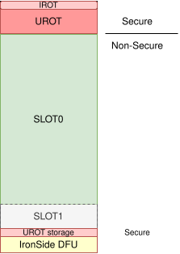

# IronSide Trusted Execution User Guide

This guide describes the following topics:

* The IronSide Trusted Execution (IronSide TE) firmware and IronSide Integration Kit
* How to install IronSide TE
* How to integrate IronSide TE and IronSide Integration Kit into the firmware and build system of a project
* How to configure IronSide TE behavior through the base and image configurations
* How to interact with IronSide TE through the tools that IronSide Integration Kit provides
* How to prepare device firmware update (DFU) artifacts that are compatible with IronSide TE

To bring up a new device and run a first application on it, start with the [IronSide Integration Kit quick start](quick-start.md).
For how to program and provision devices on a production line, see the [IronSide TE production programming guide](SPEC-production-programming.md).

This page gives an overview of IronSide TE, describes how it boots, and explains the key concepts of the boot flow.
For the pages that make up the rest of the guide, see [Guide contents](#guide-contents).

## Overview

**IronSide TE** is a set of prebuilt firmware images that provides a secure-by-default security solution for applications.

IronSide TE includes an immutable root of trust (IROT) and an updatable root of trust (UROT):

* IROT serves as a first-stage bootloader.
* UROT serves as a second-stage bootloader and provides secure services.

IronSide TE also includes IronSide DFU, the recommended DFU image implementation.
You can replace it with a custom solution, but this guide assumes that you use IronSide DFU unless stated otherwise.

The following figure shows how these images are placed in the non-volatile memory.

Together, these images provide the following features:

* Trusted execution environment isolation with secure services
* A hardware-accelerated Platform Security Architecture (PSA) Crypto interface
* Single-bank and dual-bank DFU handling
* Lifecycle state management
* Authenticated debug
* Authenticated erase operations

You develop for IronSide TE using **IronSide Integration Kit**, which contains host-side tools, OS-agnostic C libraries, application firmware samples, and build system code.

## How IronSide TE boots

The system consists of the following images:

* IROT: The immutable root of trust.
  It is protected by hardware configuration, and it verifies, updates, and boots the UROT image.
  It runs in secure mode.
* UROT: The updatable root of trust.
  It verifies and updates the App or DFU image, and makes the secure transition into it.
  It also provides secure services to the App or DFU image.
  It runs in secure mode.
* DFU: The main firmware updater image, which provides the transport for downloading firmware update candidates.
  Its entry conditions are configurable, which makes it suitable for recovery operations.
  It runs in non-secure mode.
* App: The main user image, which contains the application logic.
  This is the image that boots, except in fault or update situations.
  It runs in non-secure mode.
* Update candidate partition (SLOT1): Not strictly an image, but a shared partition that the DFU or App image writes update candidate images to.

After a reset, the system boots in the following sequence:

1. The system boots into IROT.
2. IROT checks whether SLOT1 contains a valid update candidate for UROT.
   If it does, IROT verifies and installs the candidate.
3. IROT verifies and boots UROT.
4. UROT checks the update candidate partition for App or DFU candidates, and verifies and installs them.
5. UROT decides whether to boot the DFU or App image, based on the configured DFU entry conditions and on whether the App and DFU images are valid.
6. UROT configures the secure and non-secure permissions.
7. UROT boots the App or DFU image by making a transition to non-secure mode at the start vector of that image.

From then on, the running non-secure image transitions back into UROT through secure service calls.

The following figure shows the secure boot flow.

## Key concepts

The boot flow relies on the following concepts besides the images listed above:

**Keyset**: The collection of keys that IronSide TE uses: the signing keys of the three updatable images, the authenticated operation (AUTHOP) key for the debug port, and the firmware encryption key encryption key (KEK), each in three generations.
For details, see [IronSide TE keyset](architecture.md#ironside-te-keyset).

**Update candidate**: A signed image that the running DFU or App image writes to SLOT1.
IROT verifies and installs a UROT candidate, and UROT verifies and installs App and DFU candidates.
For details, see [Firmware updates](architecture.md#firmware-updates).

**DFU entry conditions**: The conditions under which UROT boots the DFU image instead of the App image, for example an invalid application signature or a configured DFU GPIO.
For details, see [DFU entry conditions](architecture.md#dfu-entry-conditions).

For the other terms used in this guide, see the [Glossary](architecture.md#glossary).

## Guide contents

The following pages describe the tasks in the order you perform them:

* [Installing and updating firmware](installing-and-updating-firmware.md): Create a keyset, install IronSide TE on a development device, build application firmware for its bundle and install it, update or reinstall them, and update devices in the field.
* [IronSide Integration Kit samples](../samples/README.md): Build and run the application firmware samples.
  To build them from source, first set up the [sample build prerequisites](../samples/PREREQUISITES.md).
* [Limiting debugger access](debugger-access.md): Move a device to a lifecycle state that restricts the debugger, and use authenticated debug on it.

The following page explains the concepts behind IronSide TE:

* [IronSide TE architecture](architecture.md): The keyset, isolation, the applied system configuration, firmware updates and the DFU image, lifecycle states, authenticated debug, fault handling, and the glossary.

The following pages are reference material:

* [Configuring IronSide TE](configuring-ironside-te.md): The base, image, and provisioning configuration, including the partition layout.
* [Secure services and boot failure codes](secure-services.md): The PSA Crypto, PSA Attestation, platform, and boot-control services, how they affect interrupts, concurrency, and latency, and the BOOTFAIL codes that IronSide TE reports when it halts during boot.
* [IronSide Integration Kit versioning](integration-kit.md): The IronSide Integration Kit version and the IronSide TE feature level that it supports.
* [IronSide TE artifacts](artifacts-and-bundles.md): The IronSide TE firmware version and feature level, component archives and their manifest, and IronSide bundles.
* [IronSide TE releases](ironside-te-releases.md): The IronSide TE features, the fixed issues, and the component releases, by feature level and release date.

For how to prepare an IronSide bundle and its production programming artifacts, see the [IronSide TE production programming guide](SPEC-production-programming.md).

## FAQ

### Development keys

*"Is it possible to use one set of keys for development and one for production?"* <!-- rumdl-disable-line MD036 -->

Yes.
Distribute the first generation of all keys in the keyset, and use the second generation for production firmware.
All keys used by IronSide TE have multiple generations, and because the vendor owns all the keys, the vendor fully controls this process.
