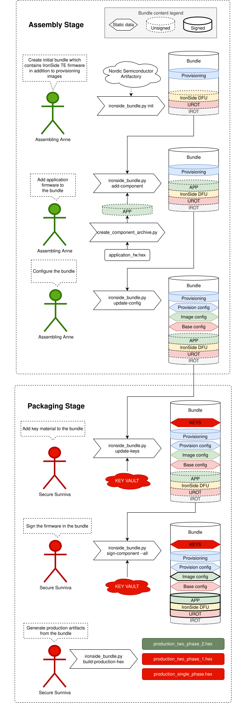
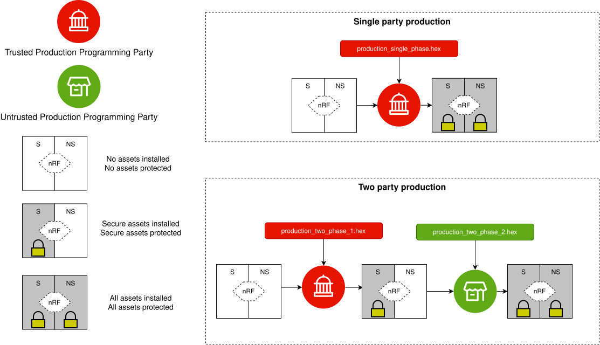

# IronSide TE Production Programming

This application note is for developers of production programming tools, and for the parties that prepare the programming artifacts from an IronSide bundle.

## Contents

1. [Introduction](#1-introduction)
2. [Lifecycle states](#2-lifecycle-states)
3. [Programming artifacts](#3-programming-artifacts)
   1. [Preparing an IronSide bundle](#31-preparing-an-ironside-bundle)
   2. [Adding application firmware](#32-adding-application-firmware)
      1. [Adding UICR.OTP data](#321-adding-uicrotp-data)
      2. [Packaging the application firmware](#322-packaging-the-application-firmware)
   3. [Adding factory-loaded application keys](#33-adding-factory-loaded-application-keys)
   4. [Building the programming artifacts](#34-building-the-programming-artifacts)
4. [Programming flow](#4-programming-flow)
5. [Selecting the access port](#5-selecting-the-access-port)
6. [Connecting to the device](#6-connecting-to-the-device)
7. [Erasing the device](#7-erasing-the-device)
8. [Programming](#8-programming)
   1. [Writing non-volatile memory and UICR](#81-writing-non-volatile-memory-and-uicr)
   2. [Writing RAM](#82-writing-ram)
   3. [Verifying the written data](#83-verifying-the-written-data)
   4. [Keeping the device from booting](#84-keeping-the-device-from-booting)
9. [Executing the provisioning firmware](#9-executing-the-provisioning-firmware)
   1. [Register and address constants](#91-register-and-address-constants)
   2. [Catching the core at reset](#92-catching-the-core-at-reset)
   3. [Halting a running core](#93-halting-a-running-core)
   4. [Starting the firmware](#94-starting-the-firmware)
   5. [Waiting for completion](#95-waiting-for-completion)
   6. [Reading the result](#96-reading-the-result)
   7. [Committing with a pin reset](#97-committing-with-a-pin-reset)
10. [Interpreting the result](#10-interpreting-the-result)
    1. [Result encoding](#101-result-encoding)
    2. [Status codes](#102-status-codes)
    3. [Operations per artifact](#103-operations-per-artifact)
    4. [Recording the device identity](#104-recording-the-device-identity)
    5. [Result buffer problems](#105-result-buffer-problems)
11. [Single-phase route](#11-single-phase-route)
12. [Two-phase route](#12-two-phase-route)
    1. [Phase 1](#121-phase-1)
    2. [Phase 2](#122-phase-2)
13. [Disconnecting](#13-disconnecting)
14. [Troubleshooting](#14-troubleshooting)
    1. [Checking the lifecycle state](#141-checking-the-lifecycle-state)
    2. [Reading the lifecycle state over ADAC](#142-reading-the-lifecycle-state-over-adac)
    3. [Erasing a protected device](#143-erasing-a-protected-device)
    4. [Recovering from a failed provisioning run](#144-recovering-from-a-failed-provisioning-run)

- [Glossary](#glossary)
- [Recommended reading](#recommended-reading)
- [Appendix A: J-Link Commander reference scripts](#appendix-a-j-link-commander-reference-scripts)
- [Appendix B: Why IronSide TE uses provisioning firmware](#appendix-b-why-ironside-te-uses-provisioning-firmware)

## 1 Introduction

This document describes how to program and provision an nRF54LM20A or nRF54LM20B device with IronSide Trusted Execution (IronSide TE) on a production line.
It is intended for developers of non-volatile memory (NVM) programming tools and production stations who add support for IronSide TE devices to their products.

This document describes every step in terms of the Arm Debug Interface.
The steps use debug port and access port register reads and writes over Serial Wire Debug (SWD), and Cortex-M33 core debug register access.
No particular debug probe or vendor tool is required.
A set of J-Link Commander files that implements the steps with one such tool ships beside this document.
For details, see [J-Link Commander reference scripts](#appendix-a-j-link-commander-reference-scripts).

Programming an IronSide TE device differs from programming a plain nRF54L Series device in one respect.
Some assets, like the device identity key, can only be created on the device itself.
Only code running on the device can write other assets, such as the records in the storage of the updatable root of trust (UROT) and IronSide TE's own protection settings.
A production station therefore programs a HEX artifact that contains both the firmware and a small provisioning firmware.
The station then starts the provisioning firmware from the debugger, waits for it to finish, and reads back its result.
The rest of the procedure is the same as for any nRF54L Series device: erasing, writing NVM, and enabling protection through a reset.

The HEX artifacts are prepared before production with the IronSide Integration Kit, from an IronSide bundle that holds the signed firmware, the configuration, and the key material.
For how to prepare them, see [Preparing an IronSide bundle](#31-preparing-an-ironside-bundle).
The chapters after chapter 3 assume that the artifacts are available.

## 2 Lifecycle states

IronSide TE moves a device through a fixed set of lifecycle states.
Three properties define each state:

- Which debug access ports are open.
- Whether the control access port (CTRL-AP) ERASEALL operation needs authentication.
- Whether the device holds an identity.

Production programming starts from a factory-fresh device and ends in the Secured state.
The following table lists the identity and the debugger access of each lifecycle state.

| State | Identity | Secure and AUX access ports | ERASEALL | Non-secure access port |
| --- | --- | --- | --- | --- |
| **Unseeded** | none | open | unauthenticated | open |
| **Empty** | enrolled | open | unauthenticated | open |
| **Open** | enrolled | open | unauthenticated | open |
| **PRoT Provisioning** | enrolled | closed | authenticated only | open |
| **Secured** | enrolled | closed | authenticated only | closed |
| **Decommissioned** | revoked | closed | none | closed |

- **Unseeded**: A device that has never been provisioned.
  The device has no identity seed and no IronSide TE firmware.
- **Empty**: An erased device that already holds an identity seed.
  ERASEALL erases NVM, the user information configuration registers (UICR), and RAM, but not the key management unit (KMU) slots that hold the seed.
  A device that is erased after provisioning therefore returns to the Empty state, not to the Unseeded state.
  The artifacts described here accept a device in either state.
- **Open**: A device with IronSide TE installed and every access port open.
  Open is a development state and is not a production target.
- **PRoT Provisioning**: The write-once UICR registers `SECUREAPPROTECT` and `AUXAPPROTECT` close the secure and AUX access ports, and `ERASEPROTECT` disables unauthenticated ERASEALL.
  The non-secure access port stays open, so application firmware can still be debugged and tested.
- **Secured**: The non-secure access port is closed as well.
  The closure method is a property of the artifact.
  For details, see [Access port closure](#access-port-closure).
- **Decommissioned**: A terminal end-of-life state, entered over authenticated debug.
  Decommissioned is not part of production programming.

A device in the PRoT Provisioning or Secured state can only be erased by an authenticated ERASEALL.
For details, see [Erasing a protected device](#143-erasing-a-protected-device).

> **Caution:** Losing the keyset that provisioned a device leaves that device permanently locked.

### Access port closure

The artifact that closes the non-secure access port does so in one of two ways, chosen when the bundle is prepared:

- **authenticated**: IronSide TE closes the non-secure access port on every boot, and a debugger that authenticates with the device's key can reopen it.
  The UICR `APPROTECT` registers stay erased.
- **hardware-fixed**: The write-once UICR `APPROTECT` registers are programmed as well, so hardware closes the port on every boot and no authentication can reopen it.

The two closure methods present different signals to the debugger.
For details, see [Checking the lifecycle state](#141-checking-the-lifecycle-state).

## 3 Programming artifacts

Bundle preparation writes one HEX file per programming step.
Which files a station receives fixes the route it runs.
The following table lists each HEX file with its route, lifecycle transition, and contents.

| File | Route | Lifecycle transition | Contents |
| --- | --- | --- | --- |
| `production_single_phase.hex` | Single-phase | Unseeded to Secured | Firmware images, UICR, secure provisioning firmware, provisioning batch |
| `production_two_phase_1.hex` | Two-phase, phase 1 | Unseeded to PRoT Provisioning | Firmware images, UICR, secure provisioning firmware, provisioning batch |
| `production_two_phase_2.hex` | Two-phase, phase 2 | PRoT Provisioning to Secured | Non-secure provisioning firmware, provisioning batch |

Each file is an Intel HEX file whose records fall into three address ranges:

| Address range | Contents | Written with |
| --- | --- | --- |
| `0x00000000` to the end of NVM | IronSide TE firmware images of the immutable root of trust (IROT), UROT, and IronSide DFU and, when the bundle carries them, the application and its data | RRAMC, see [Writing non-volatile memory and UICR](#81-writing-non-volatile-memory-and-uicr) |
| `0x00FFD000` to `0x00FFDFFC` | UICR: the hardware lifecycle registers, IronSide TE's base configuration with the firmware verification public keys, and the `UICR.OTP` data when the bundle carries it | RRAMC, see [Writing non-volatile memory and UICR](#81-writing-non-volatile-memory-and-uicr) |
| `0x20000000` and above | RAM: the provisioning firmware at the entry point address, and the provisioning batch at the command buffer address | Ordinary memory writes, see [Writing RAM](#82-writing-ram) |

You must program the RAM sections of the artifact, not only the NVM and UICR sections.
The station executes the provisioning firmware, as described in [Executing the provisioning firmware](#9-executing-the-provisioning-firmware).
The batch is the list of operations that the firmware performs.
`production_two_phase_2.hex` contains only RAM sections.

> **Caution:** The provisioning batch inside `production_single_phase.hex` and `production_two_phase_1.hex` carries the raw firmware encryption key encryption keys (KEKs) of the deployment.
> Treat those two files as secrets.

The provisioning firmware wipes the batch from RAM when it finishes or hits a fatal error, and the secrets it stores cannot be read back.
`production_two_phase_2.hex` carries no key material.

The RAM addresses in this document are those of the nRF54LM20A and nRF54LM20B.
Artifacts for other parts place the provisioning firmware's buffers elsewhere and are outside the scope of this document.

### 3.1 Preparing an IronSide bundle

An IronSide bundle can contain the firmware images, keys, filesystems, static data, configuration, and provisioning images needed to generate production programming artifacts.
For the structure of a bundle and of the component archives it holds, see [IronSide bundle](artifacts-and-bundles.md#ironside-bundle) in the IronSide Trusted Execution User Guide.

> **Note:** The commands in this chapter assume that the IronSide Integration Kit directory is your working directory.

This workflow distinguishes between **bundle preparation** and **programming** of the device.
Both **bundle preparation** and **programming** are split into **steps**.
A bundle preparation step is called a **stage**.
A programming step is called a **phase**.

You can divide bundle preparation stages and programming phases between **parties** independently.

The bundle preparation has two stages, as shown in Figure 1.



_Figure 1: Bundle preparation stages_ <!-- rumdl-disable-line MD036 -->

The assembly stage adds the required components and configures the bundle content that does not require access to the keyset.
For how to add application firmware in this stage, see [Adding application firmware](#32-adding-application-firmware).
The security provisioning stage installs keys and provisioning data into the bundle, and then signs the firmware.
For how to add application keys in this stage, see [Adding factory-loaded application keys](#33-adding-factory-loaded-application-keys).
In Figure 1, Assembling Anne runs the assembly stage and Secure Sunniva runs the security provisioning stage.
A single party can handle both roles.

How you distribute the generated production HEX files depends on the route, as described in [Programming flow](#4-programming-flow).
You can prepare an update for devices in the field with the same stages, as described in [Preparing an OTA update](installing-and-updating-firmware.md#preparing-an-ota-update) in the IronSide Trusted Execution User Guide.

### 3.2 Adding application firmware

This section describes how to merge `UICR.OTP` data into the HEX image of the application, and how to package the image and add it to the bundle.

#### 3.2.1 Adding UICR.OTP data

The application firmware component carries the `UICR.OTP` data beside its firmware image.
To add the data, complete the following steps:

1. Write the data to a `.hex` file that holds whole, word-aligned 32-bit words at addresses inside `UICR.OTP`.
   Leave out every word that must stay erased.
2. Merge the file into the HEX image of the application:

   ```sh
   scripts/internal/mergehex.py app.hex otp.hex -o app_otp.hex
   ```

   The script refuses input files that write the same address.
3. Package `app_otp.hex` as the application firmware component, as described in [Packaging the application firmware](#322-packaging-the-application-firmware).

`OTP[n]` is the word at address `0x00FFD500 + 4n`.
Each word is little-endian, so the first byte of a word is its least significant byte.
For example, the data `78563412` at address `0x00FFD500` reads as `OTP[0]` = `0x12345678` through `ironside_platform_mem_read()`.

The `check` command of `scripts/ironside_bundle.py` refuses a bundle in which the application firmware component carries a partial `UICR.OTP` word or UICR data outside `UICR.OTP`, or in which another component carries `UICR.OTP` data.
Signing the application keeps the data, because the UICR data is outside the signed image.

Each `UICR.OTP` word can be written only once, so programming this signed image onto a device that already holds its `UICR.OTP` data fails on the UICR write.
To reprogram the application on such a device, for example during development or rework, sign it with the `--no-uicr` option of `scripts/sign.py`, which leaves the UICR data out of the signed image.

#### 3.2.2 Packaging the application firmware

Use `scripts/create_component_archive.py` to package a HEX image as a component archive.
This is how you produce an archive for a component that the IronSide TE release does not provide, such as your own application firmware:

```sh
# Note, app.hex is unsigned
scripts/create_component_archive.py --hex app.hex --role app --version 1.0.0 --soc nrf54lm20b
```

The script writes the archive to the working directory and names it `<component identifier>_<soc>-<version>.zip`, because the tools locate a component by that name.
For details, see [IronSide bundle](artifacts-and-bundles.md#ironside-bundle).

The archive contains `image.hex` and `manifest.json`.
The manifest records the `name`, `soc`, `version`, and `deps` fields described in [Manifest file format](artifacts-and-bundles.md#manifest-file-format).

If the HEX image of a UROT, IronSide DFU, or application firmware component has no MCUboot metadata, the script adds the same unsigned metadata that the IronSide TE release images carry.
In that case, the `--version` value sets the image version and its security counter.
`update-keys` records that counter as the rollback counter that the devices are provisioned with, unless you sign the image with the `-v` or `-s` option of `sign-component`.

To package a DFU image linked for a DFUIMAGE size other than 32 kB, use the same command with `--role dfu-serial`.

To add the archive to a firmware bundle, use `scripts/ironside_bundle.py`:

```sh
scripts/ironside_bundle.py add-component ironside-te.iron.zip \
  ironside-te-app_nrf54lm20b-1.0.0.zip
```

### 3.3 Adding factory-loaded application keys

The IronSide bundle must contain all persistent keys owned by the applications that are programmed at the factory.
The `iron_keychain.py` tool makes it easier to add application keys to a bundle.
By default, a keyset does not contain any application-specific keys.
The following command lists the keys in a keyset:

```sh
# List all keys within a keyset
scripts/iron_keychain.py list dev
> IronSide keys:
>   . updater_g0       ECDSA P-384 key pair  Signs and verifies the IronSide TE Updater images
>   . updater_g1       ECDSA P-384 key pair  Next generation
>   . updater_g2       ECDSA P-384 key pair  Next generation
>   . app_g0           ECDSA P-384 key pair  Signs and verifies application images
>   . app_g1           ECDSA P-384 key pair  Next generation
>   . app_g2           ECDSA P-384 key pair  Next generation
>   . authopkey_g0     ECDSA P-384 key pair  Signs and verifies the ADAC authentication of a debugger
>   . authopkey_g1     ECDSA P-384 key pair  Next generation
>   . authopkey_g2     ECDSA P-384 key pair  Next generation
>   . urot_p384_g0     ECDSA P-384 key pair  Signs and verifies UROT images, with the ML-DSA-65 key
>   . urot_p384_g1     ECDSA P-384 key pair  Next generation
>   . urot_p384_g2     ECDSA P-384 key pair  Next generation
>   . urot_mldsa65_g0  ML-DSA-65 key pair    Signs and verifies UROT images, with the ECDSA P-384 key
>   . urot_mldsa65_g1  ML-DSA-65 key pair    Next generation
>   . urot_mldsa65_g2  ML-DSA-65 key pair    Next generation
>   . fw_kek_g0        AES-256 key           Firmware encryption key encryption key
>   . fw_kek_g1        AES-256 key           Next generation
>   . fw_kek_g2        AES-256 key           Next generation
> application keys:
>   (none)
```

To add application-specific keys to this keyset, use `scripts/add_application_key.py`:

```sh
# Example only; generate production keys with an approved process.
openssl rand -out aes0.key 32

scripts/add_application_key.py \
  --type AES --key-bits 256 --algorithm GCM \
  --usage ENCRYPT --usage DECRYPT --id 164 \
  --key-from-file aes0.key --keyset keyring:dev

scripts/iron_keychain.py list dev
> IronSide keys:
>   . updater_g0       ECDSA P-384 key pair  Signs and verifies the IronSide TE Updater images
> ...
> application keys:
>   key 164   AES 256-bit
>             GCM  usage ENCRYPT, DECRYPT  ROTATING
```

You can load application keys into a keyset, update them, and remove them from it.
`scripts/add_application_key.py --force` replaces the key with the same key ID, and `scripts/iron_keychain.py delete dev appkey_164` removes the key with key ID 164 from the `dev` keyset.
In a directory-based keyset, each application key is an `appkey_<id>.json` file, for example `appkey_164.json`, which `scripts/iron_keychain.py export` writes and `scripts/iron_keychain.py new --from-dir` imports together with the other keys.
After you load all keys into the keyset, update the keyset in the bundle:

```sh
scripts/ironside_bundle.py update-keys ironside-te.iron.zip --keyset keyring:dev
```

Production programming with this bundle installs the application keys.

### 3.4 Building the programming artifacts

`build-production-hex` writes the HEX files of one route from a prepared bundle.
It needs no key source, because `update-keys` already built the provisioning material that the files carry.
The following command writes `production_single_phase.hex` for the single-phase route to the `prod` directory:

```sh
scripts/ironside_bundle.py build-production-hex ironside-te.iron.zip -o prod
```

To write `production_two_phase_1.hex` and `production_two_phase_2.hex` for the two-phase route, add the `--two-phase` option:

```sh
scripts/ironside_bundle.py build-production-hex ironside-te.iron.zip -o prod --two-phase
```

For the routes and the parties that run them, see [Programming flow](#4-programming-flow).

## 4 Programming flow

A route is the production programming flow that a bundle carries provisioning firmware for, and `build-production-hex` writes the artifacts of one route.
The route determines how device programming and provisioning are divided between programming parties:

- **Single-phase route:** One trusted party performs all operations with one HEX artifact.
- **Two-phase route:** The route is split into two **phases**.
  In phase 1, a trusted party installs firmware and secrets and protects the secure assets.
  In phase 2, a party that never handles key material closes the remaining access port with a separate, non-secure HEX artifact.

Between the two phases, you can move and test the device and debug its application over the non-secure access port.
Figure 2 shows both routes and the parties that run them.



_Figure 2: Production programming flows_ <!-- rumdl-disable-line MD036 -->

Figure 3 shows the steps of both routes.

```text
   Single-phase route                Two-phase route

                                     Phase 1 (trusted party)
   Select access port                Select access port
   Connect                           Connect
   Erase                             Erase
   Program single_phase.hex          Program two_phase_1.hex
   Verify                            Verify
   Catch core at reset               Catch core at reset
   Execute provisioning firmware     Execute provisioning firmware
   Read and check result             Read and check result
   Pin reset                         Pin reset
   Disconnect                        Disconnect
                                       -> PRoT Provisioning
     -> Secured
                                     Phase 2 (any party)
                                     Select access port
                                     Connect
                                     Boot, wait for the application
                                     Program two_phase_2.hex (RAM)
                                     Halt the running core
                                     Execute provisioning firmware
                                     Read and check result
                                     Pin reset
                                     Disconnect
                                       -> Secured
```

_Figure 3: Production programming routes_ <!-- rumdl-disable-line MD036 -->

The order of the steps inside a phase matters.
In phase 1 and in the single-phase route, the device must not boot between programming and executing the provisioning firmware.
For details, see [Keeping the device from booting](#84-keeping-the-device-from-booting).
In phase 2, the device must have booted before the artifact is programmed.
For details, see [Phase 2](#122-phase-2).

## 5 Selecting the access port

The nRF54LM20A and nRF54LM20B have one Arm Cortex-M33 processor and one RISC-V coprocessor.
NVM is shared between them and is programmed through the access port of the Cortex-M33.

Over the Serial Wire Debug Port (SW-DP), the Cortex-M33 AHB access port (AHB-AP) is access port index 0.
The CTRL-AP is access port index 2.
The coprocessor's access port, index 1, is for debugging the coprocessor only and is not used in production programming.
Select an access port by writing its index to the `APSEL` field, bits 31 to 24, of the debug port `SELECT` register.

In the PRoT Provisioning and Secured states, the secure and AUX access ports are closed.
In these states, the AHB-AP performs only non-secure accesses, which phase 2 of the two-phase route relies on.
The CTRL-AP stays reachable in every lifecycle state.

## 6 Connecting to the device

Use the standard SWD Arm CoreSight Debug Access Port (DAP) protocol to enter debug interface mode.

Before the debugger can access the core, it must request the debug and system power domains.
To do so, set the `CDBGPWRUPREQ` and `CSYSPWRUPREQ` bits of the debug port `CTRL/STAT` register and wait for the corresponding acknowledge bits.
The device stays in debug interface mode as long as either request is held.

Erasing and resetting through the CTRL-AP need no core connection, only a powered-up DAP.
Programming and executing the provisioning firmware need a core connection through the AHB-AP.
A generic Cortex-M33 connection is sufficient.
Nothing in this document needs a device-specific debug profile.

## 7 Erasing the device

To erase a device that is not erase protected, use the CTRL-AP ERASEALL operation.
It erases NVM, UICR, and RAM, but not the KMU slots holding the identity seed, and it leaves the access ports open.
ERASEALL is also what disables access port protection on a device that has it enabled but is not erase protected.

The following table lists the CTRL-AP registers used for erasing and resetting, by byte offset within the access port.

| Register | Offset | Description |
| --- | --- | --- |
| `RESET` | `0x000` | Reset control. Values are levels: `0x1` soft reset, `0x2` hard reset, `0x4` pin reset, `0x0` release. |
| `ERASEALL` | `0x004` | Write `1` to start the erase. |
| `ERASEALLSTATUS` | `0x008` | `0` Ready, `1` ReadyToReset, `2` Busy, `3` Error. |
| `ERASEPROTECT.STATUS` | `0x00C` | Bit 0 (`PALL`) reads `1` when erase protection is engaged. |

_Table 1: CTRL-AP registers used for erasing and resetting_ <!-- rumdl-disable-line MD036 -->

To erase the device, complete the following steps:

1. Read `ERASEPROTECT.STATUS`.
   If bit 0 is `1`, the device is erase protected and this procedure cannot erase it.
   See [Erasing a protected device](#143-erasing-a-protected-device).
2. Write `1` to `ERASEALL`.
3. Poll `ERASEALLSTATUS` until it reads `1` (ReadyToReset) or `3` (Error).
   An erase completes within milliseconds on a fresh device.
   Allow several seconds before you treat the poll as timed out.
   Both `0` (Ready) and `2` (Busy) mean that the operation is still in progress.
4. If the status is `1`, commit with a hard reset: write `0x2` to `RESET`, then write `0x0` to `RESET`.
5. If the status is `3`, or the poll timed out, the erase failed.
   Perform a pin reset by writing `0x4` to `RESET` followed by `0x0`, reconnect, and repeat from step 2.

Figure 4 shows the erase procedure as a flowchart.

```text
   Start
     |
   Write ERASEALL = 1
     |
   Poll ERASEALLSTATUS until != 0 and != 2
     |
   ERASEALLSTATUS == 1 (ReadyToReset)? ---- No ----> CTRL-AP pin reset, retry
     |
    Yes
     |
   CTRL-AP hard reset (RESET = 2, then 0)
     |
   End: device erased, access ports open
```

_Figure 4: Erase all states_ <!-- rumdl-disable-line MD036 -->

After the hard reset, the device attempts to boot from erased memory and stops.
That is expected and harmless.
Do not perform any further reset before programming.
The erased device is in the state that the next step needs.

The hard reset commits the erase in this one place only.
Everywhere else in this document, a reset is a pin reset.
For details, see [Committing with a pin reset](#97-committing-with-a-pin-reset).

## 8 Programming

Programming writes the HEX artifact to the device in full.
The NVM and UICR sections go through the resistive random-access memory controller (RRAMC), and the RAM sections are ordinary memory writes.
All writes go through the Cortex-M33 AHB-AP.

### 8.1 Writing non-volatile memory and UICR

Writing NVM (RRAM) and UICR follows the procedure in the nRF54L Series Production Programming application note, listed in [Recommended reading](#recommended-reading).
The following table lists the RRAMC registers of the nRF54LM20A and nRF54LM20B.

| Register | Address |
| --- | --- |
| `RRAMC.TASKS_COMMITWRITEBUF` | `0x5004E008` |
| `RRAMC.READY` | `0x5004E400` |
| `RRAMC.CONFIG` | `0x5004E500` |

_Table 2: RRAMC registers_ <!-- rumdl-disable-line MD036 -->

The write buffer is 32 bytes and the RRAM data unit is 16 bytes.
The maximum write chunk is 512 bytes, selected by writing `0x2001` to `RRAMC.CONFIG`.

To write NVM and UICR, complete the following steps:

1. Write `0x2001` to `RRAMC.CONFIG`.
   This enables writes and selects the maximum write buffer size.
2. Read `RRAMC.READY` until it reads `0x1`.
3. Write the data in 512-byte chunks to its word-aligned destination addresses.
   When a chunk is not a multiple of the buffer size, write `0x1` to `RRAMC.TASKS_COMMITWRITEBUF` to commit the partial buffer.
4. After the last write, read `RRAMC.READY` until it reads `0x1`.
5. Write `0x0` to `RRAMC.CONFIG`.
   This returns NVM to read-only.

Writable ranges are program memory from `0x00000000` to the end of NVM, and UICR from `0x00FFD000` to `0x00FFDFFC`.
Only word-aligned writes are allowed in UICR.

The UICR section of the artifact holds the hardware lifecycle register `BOOTCONF`, IronSide TE's base configuration, and the `UICR.OTP` data when the bundle carries it.
Program the UICR words exactly as the artifact gives them.
The protection registers `SECUREAPPROTECT`, `AUXAPPROTECT`, `ERASEPROTECT`, and `APPROTECT` are not in the artifact.
The provisioning firmware writes them, as described in [Executing the provisioning firmware](#9-executing-the-provisioning-firmware).

### 8.2 Writing RAM

The RAM sections need no controller setup.
Write them as 32-bit words to their addresses through the AHB-AP, exactly as an image is loaded for debugging.

`production_single_phase.hex` and `production_two_phase_1.hex` have the following RAM sections:

- The secure provisioning firmware, starting at the entry point address `0x20012800`
- The provisioning batch, starting at the command buffer address `0x20061000`

`production_two_phase_2.hex` has the same two sections with the non-secure provisioning firmware in place of the secure one.

Both sections must be intact when the firmware is started.
For what destroys them, see [Keeping the device from booting](#84-keeping-the-device-from-booting).

### 8.3 Verifying the written data

To verify NVM and UICR, use one of the following methods:

- Read back every written address and compare it with the artifact.
- Compute a digest on the device and compare it with a digest of the artifact.

Verify the RAM sections by reading them back as well.
The RAM sections are as much a part of the artifact as the NVM sections.

### 8.4 Keeping the device from booting

In the single-phase route and in phase 1, the device must not reset or boot between programming the artifact and executing the provisioning firmware.
A boot that reaches the non-secure firmware overwrites the provisioning firmware.
IronSide TE keeps the low 32 KB of RAM and the secure RAM reserved for PSA key slots above it secure and hands the RAM above the reservation to the non-secure image.
The provisioning firmware sits in that RAM.
IROT and UROT alone do not touch it.
The non-secure handover does.

Any of the following events between the two steps destroys the run:

- A programming tool resets the device when programming finishes.
- An operator presses the reset button.
- A power cycle occurs.

The failure is visible.
The result buffer stays all zero.
For details, see [Result buffer problems](#105-result-buffer-problems).

The reset in [Catching the core at reset](#92-catching-the-core-at-reset) is the exception.
The core is halted before it executes a single instruction, and a warm reset does not clear SRAM, so the RAM sections survive it.

## 9 Executing the provisioning firmware

The provisioning firmware is a self-contained image in RAM.
It reads the provisioning batch at the command buffer address and executes its operations in order.
It then writes a result to the result buffer address, wipes the batch, and stops on a `BKPT` instruction.
Starting it is a matter of halting the core, pointing the core's vector table, stack pointer, and program counter at fixed addresses, and resuming.
The same constants apply to both the secure and the non-secure provisioning firmware.
The two differ only in which banked registers the debugger writes and in how the core is halted first.

### 9.1 Register and address constants

The following table lists the constants that the debugger uses to start the provisioning firmware.

| Constant | Value | Use |
| --- | --- | --- |
| Entry point | `0x20012800` | Program counter |
| Vector table | `0x20013000` | `VTOR` (secure firmware) or `VTOR_NS` (non-secure firmware) |
| Stack top | `0x20032800` | `MSP` (secure firmware), or `MSP_NS` and `PSP_NS` (non-secure firmware) |
| Program status | `0x01000000` | `xPSR`, Thumb state bit set |
| Command buffer | `0x20061000`, `0x10000` bytes | Holds the provisioning batch, which the firmware wipes |
| Result buffer | `0x20071000`, `0x8000` bytes | Written by the firmware |
| Completion timeout | 10 s | Time to wait for the `BKPT` halt |

_Table 3: Provisioning firmware constants, nRF54LM20A and nRF54LM20B_ <!-- rumdl-disable-line MD036 -->

Core registers are accessed through the Cortex-M33 debug core register selector and data registers (`DCRSR`, `DCRDR`) while the core is halted.
`VTOR` is a memory-mapped System Control Block register at `0xE000ED08`.
The reference implementation writes the non-secure `VTOR_NS` through its alias at `0xE002ED08`.

### 9.2 Catching the core at reset

The single-phase route and phase 1 use the secure provisioning firmware.
It must run in the secure state on a core that has not executed IROT since the last reset.
To catch the core at its reset vector, complete the following steps:

1. Enable halting debug: write `0xA05F0001` to `DHCSR` (`0xE000EDF0`).
2. Set the reset vector catch: set bit 0 (`VC_CORERESET`) of `DEMCR` (`0xE000EDFC`).
3. Request a system reset: write `0x05FA0004` to `AIRCR` (`0xE000ED0C`).
4. Poll `DHCSR` until bit 17 (`S_HALT`) reads `1`.
   Allow up to three seconds.

A Cortex-M33 resets into the secure state with the main stack selected, so after this step the core is secure, halted, and has executed nothing.
The RAM sections written in [Programming](#8-programming) are unchanged.

This reset is required for the following reasons:

- It guarantees the security state.
- It clears any lockup left by the boot attempt into erased memory after [Erasing the device](#7-erasing-the-device).

### 9.3 Halting a running core

Phase 2 uses the non-secure provisioning firmware.
It runs in the non-secure state on a device whose secure access port is already closed.
Catching the core at reset does not work for the non-secure provisioning firmware for the following reasons:

- A Cortex-M33 always resets into the secure state.
- A reset would also boot the resident non-secure image over the firmware programmed in RAM.

Instead, halt the running core in place: write `0xA05F0003` to `DHCSR` and poll bit 17 (`S_HALT`) until it reads `1`.

Read the program counter after the halt.
The core should be inside the resident non-secure image, that is, in NVM at or above `0x00023000`.
A halt can land inside a secure function call that the non-secure image made.
From there, redirecting the core to the provisioning firmware does not work.
If the program counter is not in non-secure NVM, resume the core, wait briefly, and halt again.
The reference Python driver allows five attempts.

### 9.4 Starting the firmware

To start the firmware with the core halted in the required state, complete the following steps:

1. Clear the first four words of the result buffer: write `0` to `0x20071000`, `0x20071004`, `0x20071008`, and `0x2007100C`.
   This makes a stale result from an earlier run unreadable as a fresh one.
2. Write the vector table address `0x20013000` to `VTOR` for the secure firmware, or to `VTOR_NS` for the non-secure firmware.
3. Write the stack top `0x20032800` to the stack pointer of the required security state.
   For the secure firmware, write `MSP`.
   The core has the main stack selected after reset, so `MSP` is also the active `SP`.
   For the non-secure firmware, write both `MSP_NS` and `PSP_NS`.
   A running image may be using either, and only the currently selected bank becomes `SP`.
4. Write the entry point `0x20012800` to the program counter.
5. Write `0x01000000` to `xPSR`.
6. Resume the core: write `0xA05F0001` to `DHCSR`.

### 9.5 Waiting for completion

The firmware signals completion by executing `BKPT`, which halts the core.
There is no in-band completion marker.
Poll `DHCSR` bit 17 (`S_HALT`) until it reads `1`, for up to the completion timeout in Table 3.

A timeout means that the firmware did not finish.
To find out why, see [Result buffer problems](#105-result-buffer-problems).
Do not proceed to the commit reset after a timeout.

### 9.6 Reading the result

Read the result buffer from `0x20071000`.
The result is one Concise Binary Object Representation (CBOR) item.
Its length depends on the number of operations in the batch, and any bytes after it are stale.
Read at least 2048 bytes, or the whole `0x8000`-byte buffer.
Save the bytes for the check in [Interpreting the result](#10-interpreting-the-result).
Also record the exported device identity, as described in [Recording the device identity](#104-recording-the-device-identity).

### 9.7 Committing with a pin reset

The protection registers the firmware wrote take effect at the next reset.
To commit the protection registers through the CTRL-AP, complete the following steps:

1. Select the CTRL-AP (access port 2).
2. Write `0x4` (pin reset) to `RESET` (offset `0x000`).
3. Write `0x0` to `RESET`.

Only a CTRL-AP pin reset is suitable here.
The other resets fail for the following reasons:

- A system reset through `AIRCR` needs a core connection, and the access port closure that takes effect at this reset removes that connection.
- A CTRL-AP hard reset sets a reset reason that IronSide TE reads as a request to enter authenticated debug rather than to boot the application.

After the pin reset, the device boots into its new lifecycle state.

## 10 Interpreting the result

A provisioning run passes when the result buffer holds one result for every operation in the batch and every result status is `0` or `-139`.
Anything else is a failure, and the device is not provisioned.

IronSide Integration Kit ships a checker that applies this rule to a saved result buffer and the artifact that produced it:

```text
scripts/internal/check_prov_result.py --bundle production_single_phase.hex --result result.bin --soc <soc> [--iak-out iak.bin]
```

Its exit code tells whether the run passed or failed, and its output names each operation and its status.
A station that does not run the checker must implement the same rule, which the rest of this chapter specifies.

### 10.1 Result encoding

The result buffer holds one CBOR (RFC 8949) map, described here in Concise Data Definition Language (CDDL):

```text
prov-output = {
    "version" => uint,          ; 9
    "results" => [+ result],    ; one per input operation, in order
}

result = {
    "status"   => int,          ; 0 on success
    ? "pubkey" => bstr .size 65 ; present for export-iak-pubkey only
}
```

Results are positional: the n-th result belongs to the n-th operation of the batch.
The batch itself is a CBOR map at the command buffer address inside the HEX file of the artifact.
A station can decode it to name the operations in a report:

```text
prov-input = {
    "version"    => uint,       ; 9
    "operations" => [+ operation],
}

operation = {
    <operation name> => <parameters>,
    ? "continue-on-error" => bool,
}
```

Exactly one operation-name key is present per operation, and it is the name used in [Operations per artifact](#103-operations-per-artifact).
The device wipes the batch from RAM when it finishes, so read it from the HEX file, not from the device.

A `version` other than `9` in either map means that the artifact and this document disagree.
In that case, treat the run as failed.

### 10.2 Status codes

A status is a Platform Security Architecture (PSA) status code: `0` (PSA_SUCCESS) on success, or a negative PSA status code from the operation.
The `ITE_ERROR_*` codes in Table 4 are the provisioning firmware's own, in the range PSA reserves for API-specific status codes.

| Status | Name | Meaning |
| --- | --- | --- |
| `0` | PSA_SUCCESS | The operation succeeded. |
| `-1` | ITE_ERROR_BAD_CMD | The batch did not decode or has the wrong version. Either case yields a single result with this status. |
| `-2` | ITE_ERROR_FAULT | A CPU fault was trapped while executing the operation. |
| `-3` | ITE_ERROR_ABORTED | An earlier operation failed, so this one did not run. |
| `-133` | PSA_ERROR_NOT_PERMITTED | The target cannot change in its current state. From `check-ikg-seed` or `enroll-ikg-seed`, the User SEED entry that the bundle enrolls cannot be enrolled. From `select-ikg-seed`, the entry that the IKG SEED selection names is not Locked. From `set-approtect`, the authenticated access port closure is already engaged. |
| `-134` | PSA_ERROR_NOT_SUPPORTED | The operation is not implemented by this provisioning firmware, or the firmware does not support the key type. |
| `-135` | PSA_ERROR_INVALID_ARGUMENT | Invalid parameters for the operation. |
| `-137` | PSA_ERROR_BAD_STATE | From `check-ikg-seed`: the device is unseeded. |
| `-139` | PSA_ERROR_ALREADY_EXISTS | The write-once target already held a value. The pass rule accepts it. |
| `-147` | PSA_ERROR_HARDWARE_FAILURE | A seed slot cannot be read, a rollback counter store is damaged, or a protection register does not hold the written value. |
| `-151` | PSA_ERROR_CORRUPTION_DETECTED | From `check-ikg-seed`: the seed slots match no seed entry, and no operation can repair them. |
| other negative values | PSA status | The PSA Crypto status the operation returned, for example `-149` PSA_ERROR_INVALID_SIGNATURE. |

_Table 4: Result status codes_ <!-- rumdl-disable-line MD036 -->

Execution stops at the first failing operation.
That operation's result carries its error status, and every later operation carries `-3` (ITE_ERROR_ABORTED).
The one exception is an operation flagged `continue-on-error` in the batch.
Its failure is recorded and the batch continues.
The identity seed write carries that flag.
This lets one artifact serve both an Unseeded and an Empty device.
On a device that already holds User SEED, the seed write reports `-139` and the batch proceeds.
The `check-ikg-seed` operations do not carry the flag.
They stop the batch before the seed write on a device whose User SEED entry cannot be enrolled, and before anything that derives from the seed if the device holds no seed that the batch can use.

The pass rule accepts `-139` because a write-once target reports it when it already holds a value.
The provisioning firmware still stops the batch at a `-139`, unless the operation carries `continue-on-error`.
On a device that was not erased, a repeated batch therefore stops at `init-urot-storage`, and every later operation reports `-3`.

### 10.3 Operations per artifact

The batch a bundle carries depends on its configuration.
The following tables give the order for each artifact of a bundle configured with `--provision-user-seed yes` and `--ikg-seed-select user`.
A bundle left at the default `no` runs one `check-ikg-seed` in place of operations 0 to 2, which stops the batch on an unseeded device.
A bundle carrying application keys adds operations at the position noted.

The batch of `production_single_phase.hex` takes the device from Unseeded to Secured.

| # | Operation | Effect |
| --- | --- | --- |
| 0 | `check-ikg-seed` | Check that the User SEED entry can be enrolled or already holds User SEED. Writes nothing. |
| 1 | `enroll-ikg-seed` | Enroll the device identity seed in the User SEED entry. `-139` if the device already holds User SEED. |
| 2 | `check-ikg-seed` | Check that the device holds User SEED. Writes nothing. |
| 3 | `select-ikg-seed` | Check that the IKG SEED selection in the UICR names a Locked entry. Writes nothing. |
| 4 | `init-urot-storage` | Initialize the UROT storage, without which UROT does not boot. |
| 5 to 7 | `provision-counter` | Write the initial rollback counters for UROT, application, and DFU. |
| 8 to 10 | `import-fw-kek` | Import the three generations of the firmware encryption key encryption key (KEK). |
| | `import-key` | One per application key the bundle carries, if any. |
| 11 | `export-iak-pubkey` | Return the public part of the Identity Attestation Key in `pubkey`. |
| 12 | `set-approtect` | Close the non-secure access port, by the configured closure method. |
| 13 | `set-auxapprotect` | Program UICR `AUXAPPROTECT`. |
| 14 | `set-eraseprotect` | Program UICR `ERASEPROTECT`. |
| 15 | `set-secapprotect` | Program UICR `SECUREAPPROTECT`. |

_Table 5: Single-phase batch_ <!-- rumdl-disable-line MD036 -->

`production_two_phase_1.hex`, Unseeded to PRoT Provisioning, is the same batch without `set-approtect`.

The batch of `production_two_phase_2.hex` takes the device from PRoT Provisioning to Secured.

| # | Operation | Effect |
| --- | --- | --- |
| 0 | `set-approtect` | Close the non-secure access port, by the configured closure method. |

_Table 6: Two-phase, phase 2 batch_ <!-- rumdl-disable-line MD036 -->

The order is a safety property of the artifact.
The key imports fail if no identity seed is present.
This stops the batch before the protection registers can seal an unseeded device.
The `set-secapprotect` operation is last because it removes the secure debug access that every other operation runs under.

### 10.4 Recording the device identity

The `export-iak-pubkey` result carries the public part of the device's Identity Attestation Key as a 65-byte SEC1 uncompressed secp256r1 point, `0x04 || X || Y`.
Attestation tokens that the device produces in the field are verified against this key.
If attestation is used, record this key against the device during production.

The instance ID of the device is the identifier that attestation tokens carry.
It is 33 bytes long: the byte `0x01` followed by the SHA-256 hash of the 65-byte public key.
Both values can be derived from the recorded key.

The identity is created once per device.
It survives ERASEALL, so a device that is reprovisioned exports the same key.
The two-phase route exports the key in phase 1 only.

### 10.5 Result buffer problems

The following table lists the result buffer problems that a station can observe, what each one means, and what to do.

| Observation | Meaning | Action |
| --- | --- | --- |
| The buffer is all zero | The firmware never ran, or the device booted between programming and execution and the resident image displaced the firmware. | Check that no reset occurred after programming. Erase and repeat the phase. |
| Fewer results than operations | The firmware faulted or was stopped before it finished. The missing operations did not pass. | Treat as a failed run. |
| The completion wait timed out | The firmware did not finish. Halt the core and read the program counter. If the program counter is outside the RAM range of the firmware, the firmware never started or the device reset. If it is inside that range, the firmware hung, or the secure firmware hit a fatal error and stopped without a result after wiping the batch. | Treat as a failed run. Do not commit. |
| The buffer does not decode as CBOR | The wrong address was read, or the firmware was still running. | Read the buffer again after you confirm that the core is halted. |
| More results than operations | The result does not belong to this batch. | Check that the saved result and the artifact are from the same run. |
| `version` is not `9` | The artifact and the tooling disagree. | Use matching tooling and artifacts. |
| A non-zero status other than `-139` | The named operation failed, and later operations report `-3`. | See [Recovering from a failed provisioning run](#144-recovering-from-a-failed-provisioning-run). |

_Table 7: Result buffer failure modes_ <!-- rumdl-disable-line MD036 -->

## 11 Single-phase route

The single-phase route uses one artifact, `production_single_phase.hex`, and one party runs it in one pass.
To run the single-phase route, complete the following steps:

1. Select the CTRL-AP and connect, as described in [Selecting the access port](#5-selecting-the-access-port) and [Connecting to the device](#6-connecting-to-the-device).
2. Erase the device, as described in [Erasing the device](#7-erasing-the-device).
3. (Optional) Perform custom programming actions, such as programming external memory.
4. Program `production_single_phase.hex` in full, including the NVM, UICR, and RAM sections, as described in [Programming](#8-programming).
   Do not reset the device afterwards.
5. Verify the written data, as described in [Verifying the written data](#83-verifying-the-written-data).
6. Catch the core at reset, as described in [Catching the core at reset](#92-catching-the-core-at-reset).
7. Start the secure provisioning firmware using the secure `VTOR` and `MSP`, as described in [Starting the firmware](#94-starting-the-firmware).
8. Wait for completion and read the result, as described in [Waiting for completion](#95-waiting-for-completion) and [Reading the result](#96-reading-the-result).
9. Check the result, as described in [Interpreting the result](#10-interpreting-the-result).
   Record the exported identity key.
   If the check fails, stop here.
10. Commit with a CTRL-AP pin reset, as described in [Committing with a pin reset](#97-committing-with-a-pin-reset).
11. Disconnect, as described in [Disconnecting](#13-disconnecting).

The device is now in the Secured state.

## 12 Two-phase route

The two-phase route uses two artifacts in two phases, and a different party can run each phase.

### 12.1 Phase 1

Phase 1 is the single-phase route run on `production_two_phase_1.hex`.
It consists of steps 1 to 11 of [Single-phase route](#11-single-phase-route), with that artifact in step 4.

The device is now in the PRoT Provisioning state.
Its secure and AUX access ports are closed, unauthenticated ERASEALL is disabled, and its non-secure access port is open.
The device can leave the trusted environment because everything that phase 1 installed is protected.
The application can be tested and debugged over the non-secure access port before phase 2.

### 12.2 Phase 2

Phase 2 closes the non-secure access port.
It runs the non-secure provisioning firmware on a device that is already running its non-secure image.
Its order is the reverse of phase 1: the device boots first, and then the artifact is programmed into the running device.
The programming tool that you use in step 3 must be able to write RAM in a running device.
Programming the artifact before the boot in step 2 does not work.
The boot places the non-secure image in the RAM that the provisioning firmware occupies.

To run phase 2, complete the following steps:

1. Select the AHB-AP and connect, as described in [Selecting the access port](#5-selecting-the-access-port) and [Connecting to the device](#6-connecting-to-the-device).
   The connection is non-secure.
2. Reset the device without erasing it and wait for it to boot into its non-secure image.
   A CTRL-AP pin reset is sufficient.
   A device that ships without an application boots IronSide DFU, which serves the purpose.
3. Program the RAM sections of `production_two_phase_2.hex` into the running device, as described in [Writing RAM](#82-writing-ram).
   The artifact has no NVM or UICR sections.
   Do not reset the device afterwards.
4. Halt the running core and confirm that its program counter is in non-secure NVM, as described in [Halting a running core](#93-halting-a-running-core).
5. Start the non-secure provisioning firmware using `VTOR_NS`, `MSP_NS`, and `PSP_NS`, as described in [Starting the firmware](#94-starting-the-firmware).
6. Wait for completion and read the result, as described in [Waiting for completion](#95-waiting-for-completion) and [Reading the result](#96-reading-the-result).
7. Check the result, as described in [Interpreting the result](#10-interpreting-the-result).
   If the check fails, stop here.
8. Commit with a CTRL-AP pin reset, as described in [Committing with a pin reset](#97-committing-with-a-pin-reset).
9. Disconnect, as described in [Disconnecting](#13-disconnecting).

The device is now in the Secured state.

## 13 Disconnecting

Use the standard SWD Arm CoreSight DAP protocol to exit debug interface mode by releasing the `CDBGPWRUPREQ` and `CSYSPWRUPREQ` requests in the debug port `CTRL/STAT` register.

We recommend power cycling the device after programming so that it performs a cold boot into its new lifecycle state.

## 14 Troubleshooting

This chapter describes how to check the lifecycle state, how to erase a protected device, and how to recover from a failed provisioning run.

### 14.1 Checking the lifecycle state

The lifecycle state of a device can be read passively from three debugger-visible signals, without a core connection:

- `DbgStatus`, bit 6 of the AHB-AP `CSW` register: `1` means AHB transfers are permitted, that is, the non-secure access port is open.
- `SPIStatus`, bit 23 of the AHB-AP `CSW` register: `1` means secure transfers are permitted, that is, `SECUREAPPROTECT` is not engaged.
- `PALL`, bit 0 of CTRL-AP `ERASEPROTECT.STATUS` (offset `0x00C`): `1` means erase protection is engaged.

| `PALL` | `DbgStatus` | `SPIStatus` | State |
| --- | --- | --- | --- |
| `0` | `1` | `1` | Unseeded, Empty, or Open. UICR `BOOTCONF` (`0x00FFD080`) distinguishes them. Erased (`0xFFFFFFFF`) means Unseeded or Empty. Bit 13 (`LOCK`) set means that IronSide TE is installed, which is the Open state. |
| `1` | `1` | `0` | PRoT Provisioning, or Secured with the authenticated closure. |
| `1` | `0` | `0` | Secured with the hardware-fixed closure, or Decommissioned. A decommissioned device holds the boot failure word `0xB8000085` in the CTRL-AP mailbox. |

_Table 8: Lifecycle state from debugger-visible signals_ <!-- rumdl-disable-line MD036 -->

The passive signals cannot tell Secured with the authenticated closure from PRoT Provisioning.
IronSide TE, not the UICR `APPROTECT` registers, enforces that closure.
To confirm the Secured state on such a device, ask IronSide TE over Authenticated Debug Access Control (ADAC).
For details, see [Reading the lifecycle state over ADAC](#142-reading-the-lifecycle-state-over-adac).

The UICR protection registers themselves can be read while the non-secure access port is open.
Each register is protected when its value is anything other than `0xFFFFFFFF`.

| Register | Addresses |
| --- | --- |
| `UICR.APPROTECT` | `0x00FFD000`, `0x00FFD01C` |
| `UICR.SECUREAPPROTECT` | `0x00FFD020`, `0x00FFD03C` |
| `UICR.AUXAPPROTECT` | `0x00FFD040`, `0x00FFD05C` |
| `UICR.ERASEPROTECT` | `0x00FFD060`, `0x00FFD07C` |

_Table 9: UICR protection registers_ <!-- rumdl-disable-line MD036 -->

### 14.2 Reading the lifecycle state over ADAC

IronSide TE implements the Arm ADAC protocol, Arm DEN 0101, over the CTRL-AP mailbox.
Its Discovery command needs no key, works in every lifecycle state, and reports the PSA lifecycle state IronSide TE itself is in.

> **Caution:** Do not read the lifecycle state over ADAC on a device between programming the artifact and executing the provisioning firmware.
> Entering ADAC boots IROT, which locks the RRAMC region table.
> For details, see [Keeping the device from booting](#84-keeping-the-device-from-booting).

Table 10 lists the mailbox registers by byte offset within the CTRL-AP.

| Register | Offset | Description |
| --- | --- | --- |
| `TXDATA` | `0x020` | Debugger to device data word. |
| `TXSTATUS` | `0x024` | `1` while the device has not yet read `TXDATA`. |
| `RXDATA` | `0x028` | Device to debugger data word. |
| `RXSTATUS` | `0x02C` | `1` while `RXDATA` holds a word the debugger has not yet read. |

_Table 10: CTRL-AP mailbox registers_ <!-- rumdl-disable-line MD036 -->

Write a word by waiting for `TXSTATUS` to read `0`, then writing `TXDATA`.
Read a word by waiting for `RXSTATUS` to read `1`, then reading `RXDATA`.
Allow five seconds for each wait.

To read the lifecycle state over ADAC, complete the following steps:

1. Drain the mailbox: while `RXSTATUS` reads `1`, read `RXDATA`.
2. Enter ADAC with a CTRL-AP hard reset: write `0x2` to `RESET`, then `0x0`.
3. Read the readiness word.
   It is `0xADAC1B07`.
4. Write the entry request `0xADAC0002`.
5. Read the acknowledge.
   It is `0xADAC000C`.
6. Send the Discovery request: write `0x00010000` (command `0x0001` in the upper half-word), then write `0x00000000` (zero bytes of request data).
7. Read the response: one word with the status in its upper half-word (`0x0000` is success), one word with the byte count of the response data, then the data words.
8. Decode the response data as a sequence of type-length-value (TLV) entries.
   Each entry is an 8-byte header followed by the value, which is padded to a multiple of four bytes.
   The header holds two reserved bytes, a 16-bit type, and a 32-bit length.
   Type `0x0008` is the PSA lifecycle, a 16-bit value.
9. Leave ADAC with a CTRL-AP pin reset: write `0x4` to `RESET`, then `0x0`.
   The device boots normally.

| PSA lifecycle | IronSide TE state |
| --- | --- |
| `0x1000` | Assembly and Test: Open |
| `0x2000` | PRoT Provisioning |
| `0x3000` | Secured |
| `0x6000` | Decommissioned |

_Table 11: PSA lifecycle values_ <!-- rumdl-disable-line MD036 -->

An Unseeded or Empty device has no IronSide TE firmware and does not answer.

### 14.3 Erasing a protected device

A device in the PRoT Provisioning or Secured state has erase protection engaged, and the CTRL-AP ERASEALL of [Erasing the device](#7-erasing-the-device) is refused.
Such a device is erased with the ADAC Erase all command.
The command requires a challenge-response authentication with the authenticated operation (AUTHOP) key of the keyset that provisioned the device.
To erase the device with IronSide Integration Kit, run the following command:

```text
scripts/adac.py erase-all --keyset <keyset> --serial-number <probe serial>
```

The command returns the device to the Empty state with its access ports open, from which the routes in this document can be run again.
The device keeps its identity seed and exports the same identity key.

Without the keyset, you cannot erase or reprogram a protected device.

### 14.4 Recovering from a failed provisioning run

A batch stops at its first failing operation, and the device is not provisioned.
The recovery depends on how far the batch got:

- If `set-eraseprotect` did not run or reported a failure, the device is not erase protected.
  Erase it, as described in [Erasing the device](#7-erasing-the-device), and repeat the phase from the beginning.
- If `set-eraseprotect` succeeded and a later operation failed, the device is erase protected.
  Erase it over ADAC, as described in [Erasing a protected device](#143-erasing-a-protected-device), and repeat the phase.
- If phase 2 failed, the device stays in the PRoT Provisioning state and nothing on it has changed.
  Repeat phase 2 from its step 2.

ERASEALL clears every write-once target of the batch except the identity seed.
When the batch is repeated after the erase, only the seed write reports `-139`, and the repeated batch passes.
A batch repeated without the erase stops at `init-urot-storage` and fails.

## Glossary

**Access port protection (APPROTECT)**: Write-once UICR registers that close the non-secure access port to the debugger on every boot.

**ADAC**: Arm Authenticated Debug Access Control, Arm DEN 0101.
The protocol IronSide TE speaks over the CTRL-AP mailbox for discovery, authenticated debug, authenticated erase, and decommissioning.

**AHB-AP**: The access port through which the debugger reads and writes the Cortex-M33's memory and core debug registers.
Access port index 0.

**Authenticated operation key (AUTHOP)**: The key of a keyset that authenticates a debugger to a device over ADAC.

**Component archive**: A ZIP file with a common directory structure that carries the firmware images of one component and a manifest file that describes them.

**Control access port (CTRL-AP)**: A Nordic access port, index 2, that stays reachable in every lifecycle state.
It carries the ERASEALL operation, reset control, the erase protection status, and the ADAC mailbox.

**Erase protection (ERASEPROTECT)**: A write-once UICR register that disables the unauthenticated CTRL-AP ERASEALL.

**Identity Attestation Key (IAK)**: The device's identity key, derived on the device from its identity seed.
Its public part is exported during production.

**IKG SEED**: The seed stored in the key management unit from which the device derives its identity key.
Enrolled once, and not erased by ERASEALL.

**IROT**: The immutable root of trust, IronSide TE's first-stage bootloader.

**IronSide bundle**: A ZIP archive of component archives, and optionally of application component archives, keys, static data, and configurations, from which bundle preparation writes the programming artifacts.

**IronSide DFU**: IronSide TE's non-secure firmware update image, which boots when no application is installed.

**Key management unit (KMU)**: The hardware block that holds keys and the identity seed in write-once slots that the CPU cannot read back.

**Keyset**: The collection of keys that IronSide TE uses: the signing keys of the three updatable images, the AUTHOP key, and the firmware encryption key encryption key (KEK), each in three generations.
A keyset can also hold the application's own keys.

**Phase**: A programming step of a route, run by one party with one HEX artifact.

**Provisioning batch**: The CBOR list of operations the provisioning firmware executes, stored in the artifact at the command buffer address.

**Provisioning firmware**: The RAM image in the artifact that the station executes to create and write assets the debugger cannot write itself.

**PRoT Provisioning**: The lifecycle state with the secure assets protected and the non-secure access port open.

**RRAMC**: The resistive random-access memory controller through which NVM and UICR are written.

**Route**: The production programming flow that a bundle carries provisioning firmware for, either single-phase or two-phase.

**Secure access port protection (SECUREAPPROTECT)**: Write-once UICR registers that close secure debug access.

**Stage**: A bundle preparation step, either assembly or security provisioning.

**UICR**: User information configuration registers, the non-volatile registers holding the hardware lifecycle configuration, IronSide TE's base configuration, and the customer data in `UICR.OTP`.

**UROT**: The updatable root of trust, IronSide TE's second-stage bootloader and secure service provider.

**UROT storage**: The secure-only NVM partition that holds the persistent keys and the application and IronSide DFU rollback counters, encrypted under a key derived from the identity seed.

## Recommended reading

- nRF54L Series Production Programming, application note 4503_270.
  The generic erase, RRAMC write, and protection procedures this document builds on.
- nRF54LM20A | nRF54LM20B Datasheet.
  RRAMC, UICR, CTRL-AP, and KMU register descriptions.
- Arm Debug Interface Architecture Specification, ADIv5 and ADIv6.
  Debug port and access port registers.
- Armv8-M Architecture Reference Manual.
  Core debug registers, banked stack pointers, and `VTOR`.
- Arm Authenticated Debug Access Control Specification, Arm DEN 0101.
- RFC 8949, Concise Binary Object Representation (CBOR), and RFC 8610, Concise Data Definition Language (CDDL).
- [IronSide Trusted Execution User Guide](README.md).
  Bundle preparation, keysets, and the IronSide Integration Kit tools.

## Appendix A: J-Link Commander reference scripts

IronSide Integration Kit ships three J-Link Commander command files under `factory/`, one for each step that executes provisioning firmware.
They are a reference implementation of [Executing the provisioning firmware](#9-executing-the-provisioning-firmware) with one particular tool, and nothing in this document depends on them.
The following table lists each script, where it is used, and the provisioning firmware it starts.

| File | Used in | Firmware |
| --- | --- | --- |
| `single_phase.jlink` | Single-phase route, steps 6 to 8 and 10 | Secure |
| `two_phase_1.jlink` | Two-phase route, phase 1 | Secure |
| `two_phase_2.jlink` | Two-phase route, phase 2, steps 4 to 6 and 8 | Non-secure |

None of the scripts erases or programs the device.
The station performs those steps with the tool it already uses, for example `nrfutil device recover` and `nrfutil device program`.
The default post-program action of `nrfutil device program` does not reset the device.
To run a script, use the following command:

```text
JLinkExe -nogui 1 -SelectEmuBySN <probe serial> -CommandFile <file>.jlink -Log <logfile>
```

The following table maps the steps in this document to Commander commands.

| Step | Commander |
| --- | --- |
| Connect as a generic core ([Connecting to the device](#6-connecting-to-the-device)) | `SelectInterface SWD`, `Speed 4000`, `Device Cortex-M33`, `Connect` |
| Catch the core at reset ([Catching the core at reset](#92-catching-the-core-at-reset)) | `Reset`, `WaitHalt 3000` |
| Halt a running core ([Halting a running core](#93-halting-a-running-core)) | `Halt`, `RReg R15` |
| Clear the result header ([Starting the firmware](#94-starting-the-firmware)) | `W4 0x20071000, 0` and the next three words |
| Write `VTOR` or `VTOR_NS` | `W4 0xE000ED08, 0x20013000` or `W4 0xE002ED08, 0x20013000` |
| Write the stack pointer | `WReg MSP, 0x20032800`, or `WReg MSP_NS, ...` and `WReg PSP_NS, ...` |
| Write the program counter and `xPSR` | `SetPC 0x20012800`, `WReg XPSR, 0x01000000` |
| Resume and wait for completion ([Waiting for completion](#95-waiting-for-completion)) | `Go`, `WaitHalt 10000` |
| Read the result ([Reading the result](#96-reading-the-result)) | `SaveBin results/result.bin, 0x20071000, 0x200` |
| Select the CTRL-AP and pin reset ([Committing with a pin reset](#97-committing-with-a-pin-reset)) | `WriteDP 2 0x02000000`, `WriteAP 0 0x00000004`, `WriteAP 0 0x00000000` |

Commander addresses access port registers by index within a 16-byte bank, where the index is the offset divided by 4.
A script first selects the access port and the bank through the debug port `SELECT` register with `WriteDP 2 <value>`.
The value is the access port index shifted left by 24 bits, plus the bank in bits 7 to 4.
The erase of [Erasing the device](#7-erasing-the-device) in the same notation is `WriteAP 1 1` to start, `ReadAP 2` to poll, and `WriteAP 0 2` followed by `WriteAP 0 0` to commit.

Commander has two limitations that affect the scripts.
Commander has no conditionals.
It cannot poll `ERASEALLSTATUS`, check the halted program counter in phase 2, or decode the result buffer.
A script that runs to completion has captured a result but has not evaluated it.
Run the result checker of [Interpreting the result](#10-interpreting-the-result), or an equivalent check, after the script.
The `WReg` command of Commander cannot name the current `SP` (register 13).
The scripts therefore write the banked stack pointers directly, and in the non-secure case they write both of them.
The scripts read the first 512 bytes of the result buffer, which hold the results of the batches in [Operations per artifact](#103-operations-per-artifact).
A batch extended with many application keys needs the larger read that [Reading the result](#96-reading-the-result) specifies.

## Appendix B: Why IronSide TE uses provisioning firmware

Some assets cannot be written from the debugger:

- The identity seed is generated by the device's key generator and never leaves it.
  Only code on the device can trigger the enrollment.
- Persistent keys and the application and IronSide DFU rollback counters are records in the UROT storage, encrypted under a key derived from the identity seed.
- The access port closure by the authenticated method is a setting that IronSide TE enforces, not a hardware register.

IronSide TE does not specify each of these as a debugger procedure.
Instead, it ships them as a firmware image that reads a list of operations from RAM and reports one status for each operation.
The station's part is the same for every operation and every deployment: program, start, wait, read, and reset.
Everything specific to a deployment is in the batch inside the artifact and is set when the bundle is prepared.
These are the keys, the counters, the closure method, and whether provisioning enrolls User SEED.
