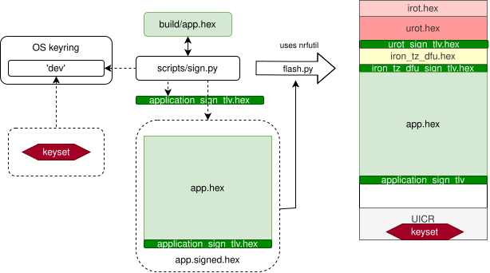

# IronSide TE architecture

This page describes the concepts behind IronSide TE that the task pages rely on.
For the boot sequence, see [How IronSide TE boots](README.md#how-ironside-te-boots).

This page contains the following sections:

* [IronSide TE keyset](#ironside-te-keyset)
* [Isolation](#isolation)
* [Applied system configuration](#applied-system-configuration)
* [Firmware updates](#firmware-updates)
* [DFU image](#dfu-image)
* [Lifecycle states](#lifecycle-states)
* [Authenticated debug](#authenticated-debug)
* [Handling faults](#handling-faults)
* [Glossary](#glossary)

## IronSide TE keyset

IronSide TE uses a predefined collection of keys called a *keyset*.
An IronSide TE keyset contains the following keys, each in three generations to support key rotation:

* ECDSA P-384 private keys for signing the application and IronSide DFU images, and for UROT an ECDSA P-384 key and an ML-DSA-65 key that sign it together
* An ECDSA P-384 private key for authenticated operations through the debug port
* 256-bit AES firmware encryption key encryption key (KEK)

IronSide TE fixes these key types; a keyset cannot use other algorithms or key sizes.
When a keyset is stored in a directory, each private key is an unencrypted PKCS#8 PEM file, and each firmware encryption KEK is a file of 32 raw bytes.

A keyset can also hold the application's own keys, which you add with `scripts/add_application_key.py`.
These keys are optional, and `scripts/ironside_bundle.py update-keys` provisions whichever keys the keyset holds.
The IronSide TE release artifact does not contain signed images or key material.
You must sign every image with the keys from your keyset.
For how to sign the images, see [Signing the bundle](installing-and-updating-firmware.md#signing-the-bundle) and [Signing the application firmware](installing-and-updating-firmware.md#signing-the-application-firmware).

The following figure shows how `scripts/sign.py` signs an application image with a key from the keyset, and how `scripts/flash.py` programs the signed image beside the IronSide TE images and the UICR:

For how to program the signed image, see [Programming the application firmware](installing-and-updating-firmware.md#programming-the-application-firmware).

> **Note:** For the guidelines that apply to production devices, see the [IronSide TE production programming guide](SPEC-production-programming.md).

### Signing key generations

Each signing key has three generations, so that you can rotate a key without reinstalling IronSide TE.
When an image signed with a newer generation is installed, the earlier generations of that signing key are revoked on the device.
Therefore, if you lose the private key of a signing key generation, you can revoke it by issuing a firmware update signed with the next generation.
To select the generation when you sign an image, see [Signing key generation](installing-and-updating-firmware.md#signing-key-generation).

## Isolation

IronSide TE runs in the secure world and boots the Application or the DFU image into the non-secure world.
The split between the two covers memory and peripherals.
IronSide TE configures the split before the non-secure image starts and locks it for the rest of the boot.
The only part that an image can change at runtime is the executable RAM region.
IronSide TE traps an access that the split does not allow as a fault.
For details, see [Handling faults](#handling-faults).

### Memory isolation

The first 140 kB of non-volatile memory hold IROT and UROT.
They are secure, and neither the Application nor the DFU image can read them.
This is the area marked Reserved in the partition diagrams.
From the SLOT0 partition base to the end of non-volatile memory, the SLOT0, SLOT1, STORAGE, and DFUIMAGE partitions are non-secure.
The UROTSTORAGE partition between STORAGE and DFUIMAGE is secure, and neither the Application nor the DFU image can read it.
For details, see [Partitioning the non-volatile memory](configuring-ironside-te.md#partitioning-the-non-volatile-memory).
The factory information configuration registers (FICR) are readable.
The user information configuration registers (UICR) are secure, so a non-secure image cannot read the base configuration or the partition table from them.
Instead, the image reads the layout from the boot report, as described below.

Secure RAM starts at the beginning of RAM and is at least 32 kB, with a size set by the base configuration.
Non-secure RAM starts at the end of the secure RAM, and its size depends on the part and on the size of the secure RAM.
For details, see [RAM layout](configuring-ironside-te.md#ram-layout).

Within the non-secure memory, the permissions depend on which image was booted and on the lifecycle state.
The Open and PRoT Provisioning states keep the firmware partitions writable and the RAM executable, so that a debugger can program firmware and run tools from RAM.
Every other state applies the restricted permissions.
The partition and RAM diagrams show the Open and PRoT Provisioning permissions in brackets.
The following table lists the permissions of each area.

| Area | App booted, Open / PRoT Provisioning | App booted, other states | DFU booted, Open / PRoT Provisioning | DFU booted, other states |
| --- | --- | --- | --- | --- |
| SLOT0 | RWX | RX | RW | RW |
| SLOT1, STORAGE | RW | RW | RW | RW |
| UROTSTORAGE | - | - | - | - |
| DFUIMAGE | RW | R | RWX | RX |
| Non-secure RAM (APP-RAM) | RWX | RW | RWX | RW |
| Executable RAM region (APP-XRAM), once defined | RX | RX | RX | RX |

On the nRF54L15, all non-secure RAM is RWX in every state and boot mode.

These permissions have the following consequences for an image:

* Outside Open and PRoT Provisioning, the Application cannot modify its own partition.
  An application update is staged in SLOT1 or written in place by the DFU image.
  For details, see [Firmware updates](#firmware-updates).
* The DFU image can write the SLOT0 partition in every state, and its own partition only in Open and PRoT Provisioning.
* SLOT1 and STORAGE are writable by both images in every state.
* The Application can read the DFU image but not execute it, and the DFU image can read but not execute the Application.
* RAM is not executable except through the executable RAM region.
  For details, see [Executing code from RAM](secure-services.md#executing-code-from-ram).
  In Open and PRoT Provisioning, all non-secure RAM is executable, which lets tools run firmware loaded into RAM.
  On the nRF54L15, all non-secure RAM is executable in every state.

Non-volatile memory is written through `ironside_platform_nvm_write()`.
For details, see [Non-volatile memory write](secure-services.md#non-volatile-memory-write).
A direct store to non-volatile memory faults even in a writable partition, because the storage controller is secure.
The service applies the permissions in the table.
The range must be non-secure, writable for the booted image and lifecycle state, and inside one of the following areas: SLOT0, SLOT1 plus STORAGE, or DFUIMAGE.
Otherwise the call returns `PSA_ERROR_NOT_PERMITTED` and writes nothing.
The range needs no alignment.

Every pointer passed to a secure service must point into non-secure memory the caller can access with the permission the service needs.
An output buffer must be writable, so it cannot lie in non-volatile memory or in the executable RAM region once that is defined.
A buffer can not straddle two areas of the table, for example APP-RAM and APP-XRAM, or SLOT0 and SLOT1.
A call that fails these checks returns `PSA_ERROR_PROGRAMMER_ERROR` before it reads or writes anything.

The permissions apply to every bus master, not only the CPU.
Peripheral DMA and the FLPR core are subject to the same rules, so their buffers must lie in non-secure memory with the permission the access needs.
A DMA transfer into secure RAM or into the executable RAM region is refused.
The device resets, and the boot report records the address and the access type.

A non-secure CPU access to secure memory, or to memory without the required permission, is a fault.
The device resets, and the next boot report carries the fault record.
For details, see [Handling faults](#handling-faults).

The boot report carries the partition layout in effect.
Its `slot0`, `slot1`, `appstorage`, and `dfuimage` fields hold the address and size of each partition, and a size of 0 means that the partition is absent.
For details, see [Boot report](secure-services.md#boot-report).
Use these values rather than build-time constants before writing to a partition.
The `layout.h` header shipped with the IronSide Integration Kit carries the layout of the bundle that the application is built for.
The permissions follow the provisioned layout, not the image.
An application built for one layout and booted on a device provisioned with another layout can therefore have code or data in a partition where it lacks the permission it needs.

### Peripheral isolation

The following peripherals are secure-only, and an application cannot use them directly.
Some of them are secure in hardware and cannot be configured otherwise.
The others have configurable security, and IronSide TE attributes them as secure.
In both cases, the attribution is fixed for the whole boot, because IronSide TE locks it before booting the application.

A non-secure access to a secure peripheral is trapped as a fault: the device resets and the next boot report carries the record.
A split-security peripheral is the exception.
Only part of its register interface is secure, and a non-secure access to that part is dropped silently, with no fault and no status anywhere.
Where IronSide TE exposes the withheld functionality, the last column names the call that does it.

| Peripheral | nRF54LM20A/B | nRF54L15 | nRF54LV10A | Secure because | Application access |
| --- | --- | --- | --- | --- | --- |
| CRACENCORE | `0x50010000` | `0x51800000` | `0x50010000` | Hardware | PSA Crypto, PSA Attestation |
| SPU00 | `0x50040000` | `0x50040000` | `0x50040000` | Hardware | - |
| MPC00 | `0x50041000` | `0x50041000` | `0x50041000` | Hardware | `ironside_devmgmt_xram_region_define()` |
| KMU | `0x50049000` | `0x50045000` | `0x50049000` | Hardware | PSA Crypto |
| RRAMC + GLITCHDET | `0x5004E000` | `0x5004B000` | `0x5004E000` | Hardware | `ironside_platform_nvm_write()`, `ironside_platform_rram_power_mode_set()` |
| CTRL-AP | `0x50052000` | `0x50052000` | `0x50052000` | IronSide TE | - |
| CRACEN | `0x50059000` | `0x50048000` | `0x50059000` | Hardware | PSA Crypto, PSA Attestation |
| SPU10 | `0x50080000` | `0x50080000` | `0x50080000` | Hardware | - |
| SPU20 | `0x500C0000` | `0x500C0000` | `0x500C0000` | Hardware | - |
| MEMCONF | `0x500CF000` | `0x500CF000` | `0x500CF000` | IronSide TE | `ironside_platform_mem_read()`, `ironside_platform_mem_write()` |
| TAMPC | `0x500EF000` | `0x500DC000` | `0x500EF000` | Hardware | - |
| SPU30 | `0x50100000` | `0x50100000` | `0x50100000` | Hardware | - |
| WDT30 | `0x50108000` | `0x50108000` | `0x50108000` | Hardware | - |
| REGULATORS + OSCILLATORS | `0x50120000` | `0x50120000` | `0x50120000` | IronSide TE | `ironside_platform_mem_read()`, `ironside_platform_mem_write()` |
| CPUC | `0xE0080000` | `0xE0080000` | `0xE0080000` | Hardware | - |
| ICACHE | `0xE0082000` | `0xE0082000` | `0xE0082000` | Hardware | - |
| `SCB.AIRCR.SYSRESETREQ` | `0xE000ED0C` | `0xE000ED0C` | `0xE000ED0C` | IronSide TE | `ironside_platform_system_reset()` |
| GPIO `PIN_CNF.CTRLSEL` | ports P0 to P3 | ports P0 to P2 | ports P0 to P1 | Hardware, split security | `ironside_platform_mem_write()` |

The last row is the only split-security entry.
IronSide TE hands the GPIO blocks to the application, which owns every pin and every other `PIN_CNF` field, but `PIN_CNF.CTRLSEL` stays secure in hardware.
That field selects whether the GPIO block, the VPR, or the GRTC drives the pad.
A non-secure read of the field returns 0, so the optional readback of the write call is the only way to confirm the routing of a pad.

Some of the entries need further explanation.
The control access port (CTRL-AP) is the Authenticated Debug Access Control (ADAC) mailbox of the debugger rather than an application interface.
To select IronSide DFU as the next boot target from the application, use `ironside_dfu_request_set()`.
WDT30 is the secure watchdog.
It is active during the IronSide TE boot and stops before the application boots.
The watchdog of the application is WDT31, which IronSide TE can start on behalf of the application from the image configuration.
The voltage glitch detector (GLITCHDET) is disabled before the application or DFU image starts and enabled only while IronSide TE handles a call from the application, except a call that sets the RRAMC low-power mode.
`ironside_platform_system_off()` disables it again before the device enters System OFF.
The system protection unit (SPU) and memory privilege controller (MPC) instances configure the isolation itself, and the only part of it that an application can change is the executable RAM region.
A non-secure write to `SYSRESETREQ` is ignored rather than trapped, so `NVIC_SystemReset()` hangs.
The application resets the device through `ironside_platform_system_reset()`.

## Applied system configuration

During the boot procedure, IronSide TE applies a range of configurations to the system on chip (SoC).
These include recommended errata workarounds, the system frequency, regulator and oscillator configurations, and protections.
The configuration is active when the Application or DFU image is booted.
The following table lists these configurations.
The list is not exhaustive, and the order of the table is not the order in which IronSide TE applies the configurations.
You must handle any errata not listed here.

| Name | Applied in | Description |
| --- | --- | --- |
| HCLKCORE clock | IROT | Sets the HCLKCORE clock to 128 MHz (`OSCILLATORS.PLL.FREQ`). The application and VPR core run at this frequency. |
| FICR trim values | IROT | Copies the per-die trim values from `FICR.TRIMCNF` into the corresponding calibration registers. |
| Instruction cache | IROT | Enables the instruction cache (`ICACHE.ENABLE`). |
| Fault handling | UROT | Configures fault-related settings. See [Handling faults](#handling-faults). |
| Debug access | UROT | Opens debug access ports through `TAMPC`, as long as they are not locked through `UICR`. See [Limiting debugger access](debugger-access.md). |
| Errata 31 | UROT | Workaround for errata 31, on every affected part. |
| Errata 37 | UROT | Workaround for errata 37, on every affected part. |
| Errata 63 | UROT | Workaround for errata 63, on every supported part (nRF54L15, nRF54LM20A/B, nRF54LV10A): IronSide TE enters constant-latency mode before every soft reset it issues, including one requested through the [Platform](secure-services.md#platform) service. Avoid CTRL-AP soft resets from a debugger; use a pin reset instead. |
| Non-secure FPU access | IROT, UROT | Allows the Application and DFU image to use the FPU (`SCB.NSACR`). |
| System reset | UROT | Makes `SYSRESETREQ` secure-only (`SCB.AIRCR.SYSRESETREQS`). The Application resets the device through the [Platform](secure-services.md#platform) service. |
| Isolation | UROT | Configures the isolation between secure and non-secure peripherals and memory. See [Isolation](#isolation). |
| RRAM low-power mode | UROT | Enables RRAMC low-power mode (`RRAMC.POWER.LOWPOWERCONFIG`). The Application can change it through the [Platform](secure-services.md#platform) service. |
| Reset reason | UROT | Reads and clears `RESET.RESETREAS` on every boot. For RESETPIN resets all other reset reasons are masked out. The Application reads the reset reason from the [boot report](secure-services.md#reset-reason). |
| Power-fail comparator | UROT | Enables the power-fail comparator (`REGULATORS.POFCON`) at the threshold set in the image configuration's power-fail comparator setting. Off unless that setting is present, see [Image configuration](configuring-ironside-te.md#image-configuration). |
| Oscillators and regulators | UROT | Applies the board configuration, see [Board crystals and regulator](configuring-ironside-te.md#board-crystals-and-regulator). |
| Non-secure watchdog | UROT | Starts the WDT31 just before the Application or DFU image boots, with the timeout set in the image configuration's watchdog setting. IronSide TE does not start the WDT31 unless that timeout is set. For more information, see [Enabling automatic watchdog timer start](configuring-ironside-te.md#enabling-automatic-watchdog-timer-start). A WDT31 that is still running from before a soft reset keeps running with its configuration. For when IronSide TE feeds it, see [Non-secure watchdog](#non-secure-watchdog). |
| Glitch detector | UROT | Disables the voltage glitch detector (`GLITCHDET`) just before the Application or DFU image boots. IronSide TE enables it only while it handles a call from the Application, except a call that sets the RRAM power mode, and `ironside_platform_system_off()` disables it again before the device enters System OFF. |

## Non-secure watchdog

The non-secure watchdog (WDT31) is the watchdog of the Application and the DFU image.
IronSide TE starts it from the image configuration, as described in [Enabling automatic watchdog timer start](configuring-ironside-te.md#enabling-automatic-watchdog-timer-start), or the Application starts it.
The WDT31 keeps running through a soft reset and a CPU lockup reset.
This includes the reset that IronSide TE performs after a fault in non-secure firmware, as described in [Handling faults](#handling-faults), and a reset that the Application requests through the [Platform](secure-services.md#platform) service.
The WDT31 then keeps counting while IronSide TE boots.

IronSide TE handles a running WDT31 in the same way, regardless of which image started it:

* IronSide TE does not stop the WDT31 or change its configuration.
  The timeout, the `CONFIG` settings, and the enabled reload registers stay as they were before the reset, including on the boot that applies an update.
* While IronSide TE copies an update into place, it feeds the WDT31 through every enabled reload register.
* IronSide TE does not feed the WDT31 at any other time.
  This includes the signature check of an update candidate, the validation of the image that IronSide TE boots, and the secure service calls of the Application.

The copy runs once per update.
If the Application resets the device in a loop before it feeds the WDT31, for example because it faults early, the WDT31 expires and causes a watchdog reset.
This also applies when SLOT1 holds a candidate that fails its signature check, which IronSide TE checks again on every boot.
With the `dog1` reset reason trigger, that reset boots the DFU image, see [Enabling automatic DFU mode triggers](configuring-ironside-te.md#enabling-automatic-dfu-mode-triggers).

Take the following into account when you choose the WDT31 timeout and update an image:

* The timeout must cover a whole boot after a soft reset, from the last feed before the reset to the first feed by the Application or the DFU image after it.
* Feed the WDT31 just before the Application requests a reset through the [Platform](secure-services.md#platform) service, so that the boot after the reset starts with the whole timeout.
  The reset after a fault in non-secure firmware follows no feed, so the timeout must also cover the time from the last feed to the fault.
* On the boot that applies an update, the time from the last feed before the reset to the first feed by IronSide TE includes the signature check of the update candidate, which can cover up to a whole update candidate partition.
  If the timeout is shorter, a watchdog reset interrupts the update.
  The watchdog reset stops the WDT31, so IronSide TE installs the update on the next boot.
  With the `dog1` reset reason trigger, that boot then starts the DFU image.
* The Application can stop the WDT31 before the reset that starts an update, if the WDT31 was started with `CONFIG.STOPEN` set.
  IronSide TE sets `CONFIG.STOPEN` when it starts the WDT31.
  If the image configuration sets a watchdog timeout, the boot after the reset starts the WDT31 again, just before the Application or DFU image boots.
* A new timeout in an updated image configuration applies from the first boot that finds the WDT31 stopped, for example after a pin reset, a power-on reset, or a watchdog reset.
* The enabled reload registers also stay enabled after an update.
  An updated Application must feed every reload register that the previous Application enabled, or the WDT31 causes a watchdog reset after the update.
* The IronSide DFU images feed a running WDT31 through every enabled reload register while they wait for SMP requests.
  A custom DFU image must also feed every enabled reload register, because the reload registers that the Application enabled stay enabled after a DFU request.

## Firmware updates

The system supports the following mechanisms for firmware updates:

* The running DFU or App image writes a firmware image candidate to the update candidate partition and resets the system.
  IROT or UROT applies the update and then boots it.
  This path is mandatory for updating the UROT and DFU images, and optional for the App image.
* The running DFU image writes to the App image in place.
  On reset, the image is verified and booted as usual, but no copy step is needed.

For the procedures, see [Staging the update for verification](installing-and-updating-firmware.md#staging-the-update-for-verification) and [Encrypting and uploading the application firmware](installing-and-updating-firmware.md#encrypting-and-uploading-the-application-firmware) for the App image, and [Updating IronSide TE without a full erase](installing-and-updating-firmware.md#updating-ironside-te-without-a-full-erase) for the UROT and DFU images.

### Rollback protection

Every signed image carries a security counter, which is normally derived from the image version value.
IronSide TE stores the counter of each installed image and accepts an image only if its counter is equal to or higher than the stored value.
An update candidate with a lower counter is refused before it is copied, and an application image with a lower counter is not booted: UROT boots the DFU image instead, as listed in [DFU entry conditions](#dfu-entry-conditions).

To explicitly set the version or the security counter when you sign an image, see [Version and security counter](installing-and-updating-firmware.md#version-and-security-counter).
This method allows you to set the counter to a different value than the one derived fom the image version.

## DFU image

The DFU image is the recommended way to install updates, and it can also serve as the recovery path.
It provides a configurable set of options to force a boot into the DFU image.
This shields it from faulty application updates that leave the application in a state that is unsuitable for DFU operations.

You can also disable the DFU image, as described in [Disabled DFU image](#disabled-dfu-image).

IronSide TE comes with IronSide DFU images, which are recommended to be used as they are, because they isolate the firmware update process in a user-independent component.
You can also write a custom DFU image, as long as it writes images with the correct MCUboot-formatted IronSide image encoding.

### DFU entry conditions

There are two sets of entry conditions: a mandatory set and a configurable set.
After reset, UROT does the following:

* It boots the DFU image when any of these conditions is met and a valid DFU image is present.
* It checks these conditions in a fixed order and boots the DFU image when one of them is met and a valid DFU image is present.
  UROT checks an explicit DFU request first, then the application image, then the reset reason trigger, then the DFU GPIO, and the fault trigger last.

For how to read which condition decided the boot, see [Boot report](secure-services.md#boot-report).

UROT always boots the DFU image in the following cases:

* The application slot does not start with the MCUboot image magic number.
* The application image signature is wrong.
* The application image rollback counter is lower than the stored ratchet counter.
* The application image has no valid rollback counter, or UROT cannot read or update the stored ratchet counter.
* A debugger selected the DFU image through a designated ADAC command.
  For details, see [Entering DFU through ADAC](#entering-dfu-through-adac).
* The application requested a DFU image boot through a secure service.
  For details, see [DFU boot selection](secure-services.md#dfu-boot-selection).

UROT also boots the DFU image in the following cases, when you configure them as described in [Enabling automatic DFU mode triggers](configuring-ironside-te.md#enabling-automatic-dfu-mode-triggers) and the application image is valid:

* The device booted with the designated DFU reset reason set.
* The device booted with the DFU GPIO sampled at the designated level.
* The device booted after the application or DFU image faulted and left a fault record.

### Entering DFU through ADAC

A connected debugger can designate the DFU image as the next boot target through the ADAC Boot mode command, which needs no key.
IronSide TE then boots the DFU image on the reset that leaves ADAC, so this path works even when the application cannot boot.
For the protocol, see [Authenticated debug](#authenticated-debug).
For the command, see [Selecting the next boot target](debugger-access.md#selecting-the-next-boot-target).

### Disabled DFU image

To disable the DFU image, set the DFUIMAGE partition size to 0.
For details, see [Partitioning the non-volatile memory](configuring-ironside-te.md#partitioning-the-non-volatile-memory).
Disabling the DFU image saves the space it takes.
Do this only if you are confident that the application image is stable enough to serve as the transport for firmware updates.

Disabling the DFU image has the following consequences:

* UROT always boots the App image if it is valid.
  Otherwise, UROT presents the device as bricked, because no image is left to fall back to.
* In-place application updates are no longer possible, because only the DFU image can perform them.
  The update candidate partition must therefore be large enough to hold an application update candidate.
  The application image is usually considerably larger than the DFU and UROT images, which leaves less space for the application itself.

## Lifecycle states

The lifecycle state (LCS) of a device decides which access the debugger interface has to it.
After you install IronSide TE as described in [Installing IronSide TE](installing-and-updating-firmware.md#installing-ironside-te), the device is in the **Open** lifecycle state: all access ports are open, and the ERASEALL operation is available.
This means that anyone with access to the device can read and modify secure assets, and erase and repurpose the device through the debugger interface.
IronSide TE supports restricting the access through the debugger interface.

This is useful in the following use cases:

1. All secure assets must be protected from the debugger interface.
2. All assets must be protected from the debugger interface.

To lift these restrictions, use an authenticated erase procedure.
For details, see [Erasing a protected device](debugger-access.md#erasing-a-protected-device).

Use case 1 covers the scenario where two different entities need debugger access to a device, and one of them must have access only to the non-secure assets.
Use case 2 covers the scenario of a device in the field, where there must be no debugger access.

To restrict the debugger access, transition the device to a lifecycle state that limits it, as described in [Limiting debugger access](debugger-access.md).

The lifecycle states that limit debugger access are PRoT Provisioning and Secured.
The following table lists the access in each lifecycle state.

| State | Secure and AUX access ports | ERASEALL | Non-secure access port |
| --- | --- | --- | --- |
| **Open** | open | enabled without authentication | open |
| **PRoT Provisioning** | closed | authenticated only | **open**: application debugging still works |
| **Secured** | closed | authenticated only | closed |

> **Caution:** If you lose the keyset, a device in a protected LCS has no usable ERASEALL operation.
> The ERASEALL operation is the only way to lift the debugger restrictions that the protected LCS enforces.
> Therefore, transition a device to a protected LCS only when you know that the keyset will be available.

## Authenticated debug

IronSide TE implements the Arm Authenticated Debug Access Control (ADAC) protocol.
With ADAC, a debugger proves that it holds the authenticated operation (AUTHOP) key of the device before IronSide TE grants access that the lifecycle state otherwise withholds.
The protocol is specified in the public Arm document *Authenticated Debug Access Control Specification* (Arm DEN 0101), which is part of PSA Certified.

ADAC commands travel over the CTRL-AP, a control access port that the debugger can always reach, in every lifecycle state and with the secure and non-secure access ports closed.
IronSide TE answers ADAC commands after a debugger-requested reset, without booting the application.
The `scripts/adac.py` tool handles this entry, the command exchange, and the reset that returns the device to normal boot, so a single command line performs a complete operation.

### Supported ADAC commands

IronSide TE supports the commands from the Arm ADAC specification listed in the following table.

| Command | Authentication | Use |
| --- | --- | --- |
| Discovery | none | Reports the lifecycle state and the ADAC properties of the device. |
| Authentication Start and Authentication Response | AUTHOP key | Challenge-response authentication. Grants the requested debug permissions. |
| Lock Debug | none | Withdraws a non-secure debug grant made by an earlier authentication. |
| Lifecycle change | AUTHOP key | Moves the device to the Decommissioned state. |

IronSide TE adds the three Nordic commands listed in the following table to the same protocol.

| Command | Authentication | Use |
| --- | --- | --- |
| Erase all | AUTHOP key | ERASEALL on a device whose erase protection is engaged. |
| Boot mode | none | Selects the application or DFU image as the next boot target. |
| Boot report | AUTHOP key | Returns the boot report of the last completed boot, in the layout of `struct ironside_boot_report`. |

Authentication uses ECDSA P-384 (ADAC cryptosystem `0x0A`): a root certificate that carries the AUTHOP key of the keyset that provisioned the device and is signed by it, a certificate for a per-session key signed by the AUTHOP key, and a token that key signs over a challenge the device generates.
The AUTHOP key has three generations.
The `--authop-gen` option selects one, and authenticating with a newer generation retires the older ones on that device.

## Handling faults

IronSide TE traps certain fatal errors, even if non-secure firmware causes them.
BusFaults, HardFaults, and SecureFaults are always taken to the secure side.
MemManage and UsageFault exceptions can land on the non-secure side, but only if they are enabled there.
Otherwise, they escalate to HardFaults.
Memory access errors caught by the MPC, in particular DMA towards memory that the application does not own, are also treated as faults on the secure side.

IronSide TE responds to a fault in non-secure firmware with a device reset.
It first records whatever it can about the fault, and after the reset, it includes that record in the boot report.
Reading the record is the only way for an application to tell its own fault from another kind of reboot.

A failure inside IronSide TE itself is handled differently, and never appears in the boot report.
When IronSide TE cannot continue booting, because a boot check fails or the IROT takes a fault, the device halts and reports a BOOTFAIL error code in the CTRL-AP mailbox.
A debugger can read that code in every lifecycle state.
For details, see [Boot failure codes](secure-services.md#boot-failure-codes).
A fault in the code of UROT itself resets the device and leaves no record.
An imprecise BusFault cannot be attributed to either secure or non-secure code, so it does not leave a record either.

The application or OS integration must incorporate its own fault handling logic into application startup.
When the fault trigger is enabled, the DFU image receives the fault record instead, as described in [Enabling automatic DFU mode triggers](configuring-ironside-te.md#enabling-automatic-dfu-mode-triggers).
If residual faults are not handled before the code that faulted last time can run again, a trivial bug during development can result in a boot loop.

IronSide Integration Kit includes a default fault handler for its own samples, called at the top of `main()`.
It prints the record over the universal asynchronous receiver-transmitter (UART) and sleeps forever.
For a representative integration, see the `psa_sha256` sample.

## Glossary

The following terms are used throughout this guide:

**Authenticated Debug Access Control (ADAC)**: The Arm protocol, specified in Arm DEN 0101, that IronSide TE implements over the control access port (CTRL-AP) mailbox for discovery, authenticated debug, authenticated erase, and decommissioning.

**Authenticated operation key (AUTHOP)**: The key of a keyset that authenticates a debugger to a device over ADAC.

**Component archive**: A ZIP file with a common directory structure that carries the firmware images of one component and a manifest file that describes them.
Each component archive is versioned separately.

**SLOT1**: The update candidate partition, which stages updates of the UROT, DFU, and application firmware.

**DFUIMAGE**: The partition at the end of the non-volatile memory that holds the DFU firmware.

**Identity Attestation Key (IAK)**: The device's identity key, derived on the device from the IKG SEED.

**IKG SEED**: The seed in the key management unit (KMU) from which the device derives the IAK, the Master Key Encryption Key (MKEK), and the MEXT.

**Immutable root of trust (IROT)**: The first-stage bootloader of IronSide TE.
It is protected by hardware configuration, and it verifies, updates, and boots the UROT image.

**IronSide bundle**: A ZIP archive that holds the component archives of IronSide TE.
It can also hold application component archives, application-specific keys, static data, and configurations.

**IronSide DFU**: The recommended DFU image of IronSide TE.
It runs in non-secure mode and provides the transport for downloading firmware update candidates.

**Keyset**: The collection of keys that IronSide TE uses, as described in [IronSide TE keyset](#ironside-te-keyset).

**Lifecycle state (LCS)**: The state of the device that decides which debugger access it allows and which memory permissions apply, for example Open, PRoT Provisioning, or Secured.

**Master External Storage Key (MEXT)**: A device-unique 256-bit AES key that only the Application uses, and only to derive keys for encrypting data in internal or external non-volatile memory.

**STORAGE**: The non-secure partition that holds the storage area of the application and DFU firmware.

**Updatable root of trust (UROT)**: The second-stage bootloader and secure service provider of IronSide TE.
It verifies, updates, and boots the App or DFU image.

**UROTSTORAGE**: The secure partition that holds the persistent keys and the application and DFU rollback counters, also called the UROT storage.
Neither the Application nor the DFU image can read it.

**User information configuration registers (UICR)**: The non-volatile registers that hold the hardware lifecycle configuration and the base configuration of IronSide TE.
