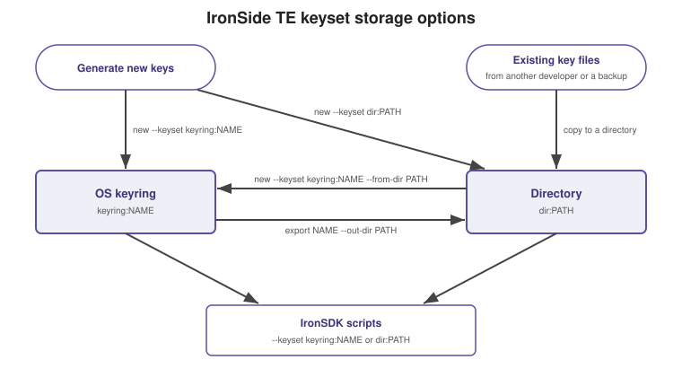
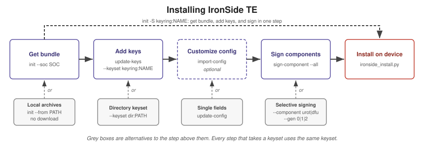
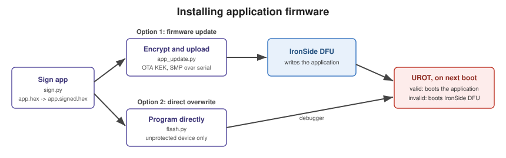
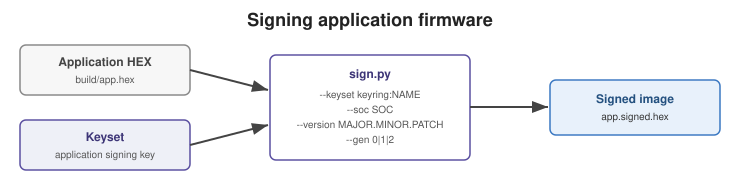
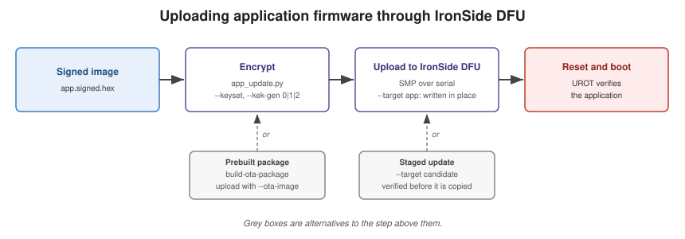
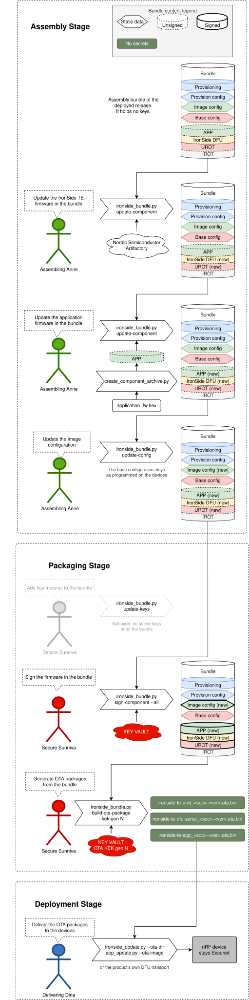

# Installing and updating firmware

This guide describes how to install and update IronSide TE and application firmware on a device in a development environment with unlimited access to the device.
This includes how to prepare and deliver an update to devices in the field.

The sections of this guide expand on the content described in the [IronSide Integration Kit quick start](quick-start.md) by documenting available processes in more detail.
The [IronSide TE architecture](architecture.md) page explains the concepts behind them.

**You are using a pre-release version of IronSide TE and IronSide Integration Kit.
Everything is subject to change before the official release.**

> **Caution:** Do not use these steps in a production environment.
> For installation steps for a production environment, see the [IronSide TE production programming guide](SPEC-production-programming.md).

<!-- -->

This page contains the following sections:

* [Creating a keyset](#creating-a-keyset)
* [Installing IronSide TE](#installing-ironside-te)
* [Building application firmware for a bundle](#building-application-firmware-for-a-bundle)
* [Installing application firmware](#installing-application-firmware)
* [Updating IronSide TE](#updating-ironside-te)
* [Updating devices in the field](#updating-devices-in-the-field)
* [Reinstalling IronSide TE](#reinstalling-ironside-te)
* [Firmware signing options](#firmware-signing-options)
* [Debugging why the application firmware is not booted](#debugging-why-the-application-firmware-is-not-booted)

> **Note:** The following sections assume that the IronSide Integration Kit directory is your working directory.

## Creating a keyset

IronSide TE uses a predefined collection of keys called [keyset](architecture.md#ironside-te-keyset).

Before you install IronSide TE, you must create the keyset that you sign every image with.
You can do it in the following ways:

* Generate the keyset - If you are the first to install IronSide TE on the device, or you plan to reinstall IronSide TE on it.
  If you lost the keyset of a device that already has IronSide TE installed, see [Reinstalling IronSide TE after losing the keyset](#reinstalling-ironside-te-after-losing-the-keyset).
* Import the keyset - If developers share a device and you do not want to reinstall IronSide TE.

The following figure is an overview of the available options for creating and storing a keyset:



This section contains the following subsections:

* [Generating new local keys](#generating-new-local-keys)
  * [Generating a keyset into the OS keyring](#generating-a-keyset-into-the-os-keyring)
  * [Generating a keyset into a directory](#generating-a-keyset-into-a-directory)
* [Importing existing keys](#importing-existing-keys)

### Generating new local keys

You can store generated keys using one of the following options:

* In the OS keyring (default)
* In a directory

The remaining installation steps assume that the OS keyring contains a keyset named `dev`.
If the OS keyring contains only one keyset, you do not need to pass the `--keyset` parameter.
If you use a directory-based keyset, pass `--keyset dir:PATH` instead of `--keyset keyring:dev`.

#### Generating a keyset into the OS keyring

The following command generates a keyset named `dev` and stores it in the OS keyring:

```sh
# Generates and stores a new keyset named 'dev' in the OS keyring
scripts/iron_keychain.py new --keyset keyring:dev
```

> **Note:** The OS keyring needs an unlocked desktop session (GNOME Keyring or KWallet over D-Bus).
> A plain SSH session has no desktop session, so keyring reads and writes fail with a locked-collection error.
> In this situation, either unlock the keyring or use a directory-based keyset.
> For how to use the keyring on a headless Linux system, see the [keyring package documentation](https://pypi.org/project/keyring/).
> To use a directory-based keyset over SSH, pass `--keyset dir:PATH`, as described in [Generating a keyset into a directory](#generating-a-keyset-into-a-directory).

#### Generating a keyset into a directory

The following command generates a keyset and stores the keys as files in the `keys` directory, which it creates if it does not exist:

```sh
scripts/iron_keychain.py new --keyset dir:keys
```

##### Exporting an OS keyring keyset to a directory

To copy a keyset that is already in the OS keyring to a directory, run the following command:

```sh
scripts/iron_keychain.py export dev --out-dir keys
```

### Importing existing keys

To import keys, complete the following steps:

1. Place the key files in a directory with the following structure:

   ```text
   ls /tmp/keys

   app_g0.pem
   app_g1.pem
   app_g2.pem
   authopkey_g0.pem
   authopkey_g1.pem
   authopkey_g2.pem
   fw_kek_g0.bin
   fw_kek_g1.bin
   fw_kek_g2.bin
   updater_g0.pem
   updater_g1.pem
   updater_g2.pem
   urot_mldsa65_g0.pem
   urot_mldsa65_g1.pem
   urot_mldsa65_g2.pem
   urot_p384_g0.pem
   urot_p384_g1.pem
   urot_p384_g2.pem
   ```

   This is the same structure that `iron_keychain.py new --keyset dir:PATH` and `iron_keychain.py export` write.

   The `app`, `updater` and `authopkey` files are the ECDSA P-384 keys that sign the application and IronSide DFU images and the ADAC certificates.
   The `urot_p384` and `urot_mldsa65` files are the ECDSA P-384 and ML-DSA-65 keys that sign UROT, and the `fw_kek` files are the firmware encryption key encryption keys (KEKs).
   For the key types and file formats, see [IronSide TE keyset](architecture.md#ironside-te-keyset).

   `iron_keychain.py` checks each file when it imports it and stops with an error that names any file in the wrong format.
   A missing file does not stop the import, but `ironside_bundle.py update-keys` later revokes every signing key generation that the keyset does not hold, and it refuses to run if a firmware encryption KEK is missing.
   Make sure that the directory contains all 18 files.

2. Import the keys into the OS keyring.
   The following command imports them into a keyset named `dev`:

   ```sh
   scripts/iron_keychain.py new --keyset keyring:dev --from-dir /tmp/keys
   ```

   To use the directory without importing it, skip this step and pass `--keyset dir:/tmp/keys` to the scripts instead.

## Installing IronSide TE

This section explains the individual steps for preparing the IronSide TE firmware for installation.
For simplified installation steps, see [IronSide Integration Kit quick start](quick-start.md).

You can install the IronSide TE firmware on the device after [creating a keyset on the host system](#creating-a-keyset).
IronSide TE is delivered as a single package of several archives, the **IronSide bundle**.
Use the bundle tool (`scripts/ironside_bundle.py`) to manage an IronSide bundle.



This section contains the following subsections:

* [Requirements for download](#requirements-for-download)
* [SoC compatibility](#soc-compatibility)
* [Downloading IronSide TE](#downloading-ironside-te)
* [Creating a bundle from local component archives](#creating-a-bundle-from-local-component-archives)
* [Inspecting the bundle contents](#inspecting-the-bundle-contents)
* [Adding keys to the bundle](#adding-keys-to-the-bundle)
* [Customizing bundle configuration](#customizing-bundle-configuration)
* [Signing the bundle](#signing-the-bundle)
  * [Confirming the signature](#confirming-the-signature)
* [Combining download with signing](#combining-download-with-signing)
* [Installing the signed bundle](#installing-the-signed-bundle)

### Requirements for download

Downloading the bundle requires access to Nordic Semiconductor Artifactory.
Contact your Nordic Semiconductor representative for access.

By default, the tool opens a browser for authentication.
On a headless system, store a token in `~/.netrc` instead, using the following line:

```text
machine files.nordicsemi.com login [username] password [INSERT_TOKEN_HERE]
```

<!-- internal-only:start -->
> **Nordic employees:** Access to Nordic Semiconductor Artifactory means membership in one of the `ci-read` groups on HelloID.
<!-- internal-only:end -->

### SoC compatibility

An IronSide bundle is built for one SoC.
The supported SoCs differ in NVM and RAM size, so their partition layouts differ, and a bundle for one SoC cannot run on another.
Downloading has no default SoC, so `init` requires `--soc`.

The following table lists the `--soc` value for each supported SoC:

| SoC | `--soc` value | Development kit |
| --- | --- | --- |
| nRF54LM20A | `nrf54lm20a` | - |
| nRF54LM20B | `nrf54lm20b` | nRF54LM20 DK |
| nRF54LV10A | `nrf54lv10a` | nRF54LV10 DK |
| nRF54L15 | `nrf54l15` | nRF54L15 DK |

To read the SoC of a connected device, run `nrfutil device device-info --serial-number <serial number>`.
The `--soc` value is the reported `deviceName` in lower case.

The bundle records its SoC, and `show` prints it after the bundle name.
Pass the same `--soc` value to every other command that takes one, such as `sign.py`.
`ironside_install.py` reads the SoC of the attached device and stops before it programs anything if the bundle targets another SoC.

### Downloading IronSide TE

To download the latest IronSide TE firmware and bundle it, use the `init` subcommand:

```sh
scripts/ironside_bundle.py init ironside-te.iron.zip --soc nrf54lm20b
```

### Creating a bundle from local component archives

To create a bundle without downloading, for example on a host without access to Nordic Semiconductor Artifactory, pass a component archive or a directory of component archives with `--from`:

```sh
scripts/ironside_bundle.py init ironside-te.iron.zip --from components/
```

`init` takes the SoC from the component archives, so you do not pass `--soc`.
`--from` cannot be combined with the download options, such as `--soc` or `--channel`.
To replace an existing bundle, pass `--force`.
`init` skips files that are not component archives and lists them in its output.
To omit the file name, all component archives must be for the same SoC and the same channel.
You can also pass `-S` with `--from`.

### Inspecting the bundle contents

You can inspect the contents of the `ironside-te.iron.zip` bundle using the `show` subcommand:

```sh
scripts/ironside_bundle.py show ironside-te.iron.zip
```

The output of this command shows the bundle components, configuration, and signing status.
A newly downloaded bundle contains the default configuration and unsigned components, as in the following example output for the nRF54LM20B bundle:

```text
ironside-te.iron.zip  (nrf54lm20b)

components:
flags: C/d/-=config (-=unconfigurable); g0..g2=signed; u-=unsigned; --=not signable (4 chars)

- u-  ironside-te-dfu-serial       fl1   0.3.0@nrf54lm20b     2026-10-05 release_ironside-te-dfu-serial_fl1_nrf54lm20b-0.3.0
d --  ironside-te-irot             fl1   0.3.0@nrf54lm20b     2026-10-05 release_ironside-te-irot_fl1_nrf54lm20b-0.3.0
- --  ironside-te-prov-nonsecure   fl1   0.3.0@nrf54lm20b     2026-10-05 release_ironside-te-prov-nonsecure_fl1_nrf54lm20b-0.3.0
- --  ironside-te-prov-secure      fl1   0.3.0@nrf54lm20b     2026-10-05 release_ironside-te-prov-secure_fl1_nrf54lm20b-0.3.0
d u-  ironside-te-urot             fl1   0.3.0@nrf54lm20b     2026-10-05 release_ironside-te-urot_fl1_nrf54lm20b-0.3.0

base configuration:
irot:
slot1-size-kb:         128 kB
storage-size-kb:         64 kB
urotstorage-size-kb:     4 kB
dfuimage-size-kb:        32 kB
urot pubkey: none provisioned
urot:
dfu pubkey: none provisioned
app pubkey: none provisioned
authopkey pubkey: none provisioned

urot image configuration:
dfu-trigger-gpio:          disabled
dfu-trigger-resetreas:     none
dfu-trigger-fault:         disabled
wdtstart-crv-ms:           off
pof:                       disabled

provisioning configuration:
not prepared: run update-keys to provision a keyset and its provisioning firmware

pass -v for the full listing: key values and per-component detail
```

### Adding keys to the bundle

Before you install the bundle on a device, you must add the public verification keys from your keyset to the bundle and sign the IronSide TE components with the corresponding private keys.

To add the public keys to the bundle, use the `update-keys` subcommand:

```sh
scripts/ironside_bundle.py update-keys ironside-te.iron.zip --keyset keyring:dev
```

When you inspect the bundle again, the listing shows the added public keys.
The default listing names the generations that each role provisions, for example `urot pubkey: g0, g1, g2`.
To print the key values, enable verbose mode with `show -v`.
Each value is the SHA-256 of the generation's public key; for UROT it is the SHA-256 of the generation's ECDSA P-384 public key followed by its ML-DSA-65 public key:

```sh
scripts/ironside_bundle.py show -v ironside-te.iron.zip
```

```text
base configuration:
irot:
slot1-size-kb:         128 kB
storage-size-kb:         64 kB
urotstorage-size-kb:     4 kB
dfuimage-size-kb:        32 kB
urot pubkey:
g0: 3dddece46c730025ef7c39a5d4cd7fc58a803f8735a8e4efdeb3f3437feb1e7e (provisioned)
g1: 1c93c09eeecf4d5486b71278acd0ddf94012bbbf7da55bdf2f0fcb04b37fd362 (provisioned)
g2: a11e00d9806ee18ed8072fabd40b66fcd1fa5bc639bf3be375b456b553b631dd (provisioned)
urot:
dfu pubkey:
g0: d60f91a195dc862dd31b9bb47fb7d443f0add4939801ccd4f1a3506ca58f0e16 (provisioned)
g1: 595710d61216ac32632f66b465e74ff14400ad3819f3ca5dbec75c8ae645a13f (provisioned)
g2: c0210a9acc6dbdb7f29a3afc5ec166302a4f41c8b883e83058fcc66339aeff4d (provisioned)
app pubkey:
g0: 02a968407375eda54c247ad37fea6a0398be5f42670fe541938bf872ad466d2a (provisioned)
g1: 6aaa7b220fa0eb3c3482374ff9bdd613d73f03303d5b8c6fa6265bb5285e5303 (provisioned)
g2: d087789747819f5220c03a3cc99db36223b2ca214aaa3c3c8260b575c14237c0 (provisioned)
authopkey pubkey:
g0: 3160af995cf06f50125ee3ba867e57da4eb6caff3e9668669c2d2bb561bc1b62 (provisioned)
g1: b33334b7a2d21e59278d45cf860545422e9d82ed1b02d3bd4f5252c5501594ae (provisioned)
g2: d6e5c0e690668d9fcfac1e835d724e4a1f89701be9465084788561d9facc6a5e (provisioned)
authlock:        provisioned
```

### Customizing bundle configuration

Before you install the bundle on the device, you can customize its configuration further with the `update-config` or `import-config` subcommand.
For the available configuration options, see [Configuring IronSide TE](configuring-ironside-te.md).
The following example imports a configuration from JSON files:

```sh
# Example for illustration purposes - see Configuring IronSide TE for details.
scripts/ironside_bundle.py import-config ironside-te.iron.zip \
--base ironside-te-config.base.json --image ironside-te-config.image.json
```

The bundle now contains the public keys from the keyset, but the components are not yet signed with the corresponding private keys.

### Signing the bundle

To sign the components, use the `sign-component` subcommand.

You can sign all components at once or some of the components at a time:

* The `--all` option signs every signable component in the bundle: UROT, IronSide DFU, and an application component if the bundle holds one.
IROT and the provisioning firmware are not signed with your keys, so `show` lists them as not signable (`--`).
After signing, `sign-component` sets the [rollback counters](architecture.md#rollback-protection) that the bundle provisions from the newly signed images.

* To sign only some components, name each one with `--component` instead of `--all`.
You can name a component by its role, such as `urot`, `dfu`, or `app`, or by its component identifier, with or without the `ironside-te-` prefix.
You can repeat `--component` to sign several components in one command, for example `--component urot --component dfu`.
If you pass `--all`, `sign-component` ignores `--component`.

For the version, security counter, and key generation options, see [Firmware signing options](#firmware-signing-options).

The following commands sign the UROT and IronSide DFU components with generation 0:

```sh
# Sign the ironside-te-urot component using the UROT verification key generation 0.
# You can specify either the full component name 'ironside-te-urot' or the shortened form 'urot'.
scripts/ironside_bundle.py sign-component ironside-te.iron.zip --component urot --gen 0

# Sign the ironside-te-dfu-serial component using DFU verification key generation 0.
# You can specify either the full component name 'ironside-te-dfu-serial' or the shortened form 'dfu'.
scripts/ironside_bundle.py sign-component ironside-te.iron.zip --component dfu --gen 0
```

#### Confirming the signature

To confirm that both components are signed with generation 0 keys (`g0`), use the `show` subcommand:

```text
components:
flags: C/d/-=config (-=unconfigurable); g0..g2=signed; u-=unsigned; --=not signable (4 chars)

- g0  ironside-te-dfu-serial       fl1   0.3.0@nrf54lm20b     2026-10-05 release_ironside-te-dfu-serial_fl1_nrf54lm20b-0.3.0
C --  ironside-te-irot             fl1   0.3.0@nrf54lm20b     2026-10-05 release_ironside-te-irot_fl1_nrf54lm20b-0.3.0
- --  ironside-te-prov-nonsecure   fl1   0.3.0@nrf54lm20b     2026-10-05 release_ironside-te-prov-nonsecure_fl1_nrf54lm20b-0.3.0
- --  ironside-te-prov-secure      fl1   0.3.0@nrf54lm20b     2026-10-05 release_ironside-te-prov-secure_fl1_nrf54lm20b-0.3.0
C g0  ironside-te-urot             fl1   0.3.0@nrf54lm20b     2026-10-05 release_ironside-te-urot_fl1_nrf54lm20b-0.3.0
```

### Combining download with signing

To add the keys from a keyset and sign every component in the same step, pass the keyset with `-S`:

```sh
scripts/ironside_bundle.py init ironside-te.iron.zip --soc nrf54lm20b -S keyring:dev
```

This runs `update-keys` and then `sign-component --all` with generation 0 of the signing keys, as described in [Adding keys to the bundle](#adding-keys-to-the-bundle) and [Signing the bundle](#signing-the-bundle).
The [quick start guide](quick-start.md) uses this form.
To customize the configuration before signing, or to sign with another key generation, run the steps separately instead.

### Installing the signed bundle

> **Note:** Installation changes the [lifecycle state](architecture.md#lifecycle-states) of the device.
> `ironside_install.py` erases the device to the Empty state, installs IronSide TE, and leaves the device in the Open state, with all access ports open.
> If IronSide TE is already installed, the tool stops unless you pass `--force`, as described in [Reinstalling IronSide TE](#reinstalling-ironside-te).

When the `ironside-te.iron.zip` bundle is signed, you can install it on the device.
For the first installation on a new device, you must configure [User SEED provisioning](configuring-ironside-te.md#user-seed-provisioning), which enrolls the seed that the device derives its keys from.
The default value of `--provision-user-seed`, `no`, does not seed the device, so the installation stops on a new device.
Currently produced devices have no pre-programmed Nordic SEED, so set `--provision-user-seed` to `yes`:

```sh
scripts/ironside_bundle.py update-config ironside-te.iron.zip --provision-user-seed yes
```

To erase your device and install the bundle from scratch, use the `ironside_install.py` tool:

```sh
scripts/ironside_install.py ironside-te.iron.zip
```

The device is now ready to run applications signed with the keyset provisioned to the device.
Apart from User SEED provisioning, these steps program the default configuration for all options.
To customize the options, see [Configuring IronSide TE](configuring-ironside-te.md).
To restrict debugger access by moving the device to the PRoT Provisioning or Secured state, see [Limiting debugger access](debugger-access.md).

## Building application firmware for a bundle

The amount of resources available to an application (for example, RAM) depends on the configuration of the IronSide TE firmware bundle `ironside-te.iron.zip` that you downloaded and installed on the device.
Application firmware must therefore be built based on the bundle configuration.

The partition sizes of the base configuration place the application partition in non-volatile memory, and its key slot storage size places the start of non-secure RAM.

To generate the configuration of a bundle to a C header, run the following command:

```sh
scripts/ironside_bundle.py export-config ironside-te.iron.zip --app-header config/ironside_bundle_config.h
```

Add the directory of this header to the include path of the application build, and of the linker script preprocessing if the linker script includes `ironside_client/layout.h`.
The `ironside_client/layout.h` header will include it, and fail to compile without it.

## Installing application firmware

> **Note:** The steps in this section sign the application firmware and install it on a development device.
> For devices in the field, build the OTA packages as described in [Preparing an OTA update](#preparing-an-ota-update).

The following figure shows the steps of the application firmware installation flow:



IronSide TE executes application firmware only if the firmware is signed with the [keyset](#creating-a-keyset).

This section contains the following subsections:

* [Signing the application firmware](#signing-the-application-firmware)
* [Programming the application firmware](#programming-the-application-firmware)
  * [Uploading the application firmware using IronSide DFU](#uploading-the-application-firmware-using-ironside-dfu)
    * [Encrypting and uploading the application firmware](#encrypting-and-uploading-the-application-firmware)
    * [Uploading a prebuilt update artifact](#uploading-a-prebuilt-update-artifact)
    * [Staging the update for verification](#staging-the-update-for-verification)
    * [Querying the boot report](#querying-the-boot-report)
  * [Directly overwriting the application firmware](#directly-overwriting-the-application-firmware)

### Signing the application firmware

IronSide Integration Kit provides the `sign.py` script, which turns a firmware HEX file into a signed image that UROT verifies before it boots the application.



The following command wraps and signs `build/app.hex` with the application private key from the `dev` keyset:

```sh
scripts/sign.py build/app.hex -o app.signed.hex \
--keyset keyring:dev --soc nrf54lm20b --version 1.0.0.0
```

For the version, security counter, and key generation options, see [Firmware signing options](#firmware-signing-options).

### Programming the application firmware

To program the application firmware on the device, use one of the following options:

* Upload the application firmware through a firmware update.
  `app_update.py` resets the device into IronSide DFU, uploads the image, and then resets the device again.
* Overwrite the existing application directly.
  `flash.py` resets the device with a pin reset after programming.
  To leave the device without resetting it, pass `--no-reset`.

In both cases, UROT verifies the new application on the boot that follows the reset.

> **Note:** Programming the application does not change the [lifecycle state](architecture.md#lifecycle-states) of the device, but the state limits which option you can use.
> A firmware update works in every lifecycle state.
> A direct overwrite needs the non-secure access port, so it works only in the Open and PRoT Provisioning states.

#### Uploading the application firmware using IronSide DFU

Nordic-provided IronSide DFU images require an encrypted transport, so you must encrypt the signed image before you upload it.
The `app_update.py` tool encrypts the image with a transient key.
It then includes the transient key in metadata encrypted with the firmware encryption key encryption key (KEK).

The following figure shows the upload steps and their alternatives:



##### Encrypting and uploading the application firmware

To encrypt the application firmware and upload it with the IronSide DFU image, run the following command:

```sh
# Encrypt the signed image and upload it to the device.
# Firmware encryption KEK generation 0 is used to encrypt the transient key.
scripts/app_update.py app.signed.hex --keyset keyring:dev --kek-gen 0
```

A successful upload means that the image was programmed, not that it will boot.
On the next boot, UROT verifies the application, and if the verification fails, UROT boots the DFU image instead.
For details, see [Debugging why the application firmware is not booted](#debugging-why-the-application-firmware-is-not-booted).

##### Uploading a prebuilt update artifact

`ironside_bundle.py build-ota-package` builds the encrypted update artifact without uploading it, as described in [Preparing an OTA update](#preparing-an-ota-update).
To upload the artifact without re-encryption, add the `--ota-image` option to the command:

```sh
scripts/app_update.py ota/ironside-te-app_nrf54lm20b-1.1.0.ota.bin --ota-image
```

##### Staging the update for verification

By default, IronSide DFU writes the uploaded image directly into the application slot, and UROT verifies it on the next boot.
To verify the signature and the [rollback counter](architecture.md#rollback-protection) before the installed application is replaced, pass `--target candidate`:

```sh
scripts/app_update.py app.signed.hex --keyset keyring:dev --kek-gen 0 --target candidate
```

IronSide DFU stages the image in the candidate partition, and UROT copies it into the application slot only if it passes verification.
The image must fit SLOT1.

##### Querying the boot report

While the IronSide DFU image is running, you can query the IronSide boot report through the Simple Management Protocol (SMP) transport:

```sh
scripts/smp_boot_report.py --port /dev/ttyACM0
```

#### Directly overwriting the application firmware

If the non-secure access port of the device is open, that is, in the Open or PRoT Provisioning [lifecycle state](architecture.md#lifecycle-states), you can overwrite the application firmware partition directly with the new firmware.
To do so, run the following command:

```sh
scripts/flash.py app.signed.hex
```

> **Caution:** `flash.py` does not check the image before it overwrites the application, and neither does an `app_update.py` upload to the default `--target app`.
> An image signed with another keyset or with a lower security counter than the installed application replaces it, and on the next boot UROT boots IronSide DFU instead.
> An upload with `--target candidate` refuses such an image before it replaces the installed application, as described in [Staging the update for verification](#staging-the-update-for-verification).
> No tool or IronSide TE component checks which SoC an application was built for, so make sure that you build the application for the SoC of the device.

`flash.py` erases only the flash ranges that the image covers and pin-resets the device after programming.
To leave the device unreset, pass `--no-reset`.
`flash.py` passes other arguments to `nrfutil device program`; when more than one device is connected, pass `--serial-number <serial number>`.

## Updating IronSide TE

> **Note:** The steps in this section update IronSide TE on a development device.
> For devices in the field, build the OTA packages as described in [Preparing an OTA update](#preparing-an-ota-update).

You can update IronSide TE on a device in the following ways:

* Without a full erase - Updates the *updatable* IronSide TE components, `ironside-te-urot` (UROT) and `ironside-te-dfu-serial` (IronSide DFU), and keeps everything else on the device.
* With a full erase - Required to update `ironside-te-irot` (IROT), the [base configuration](configuring-ironside-te.md#base-configuration), or the keyset.


This section contains the following subsections:

* [Updating IronSide TE without a full erase](#updating-ironside-te-without-a-full-erase)
  * [Updating selected components](#updating-selected-components)
* [Updating IronSide TE with a full erase](#updating-ironside-te-with-a-full-erase)

### Updating IronSide TE without a full erase

> **Note:** An update does not change the [lifecycle state](architecture.md#lifecycle-states) of the device.
> `ironside_update.py` uploads the components through IronSide DFU, so it works in every lifecycle state.

To update all updatable components from a signed bundle, use the `ironside_update.py` tool:

```sh
scripts/ironside_update.py ironside-te.iron.zip
```

#### Updating selected components

To update only some of the components, name each one with the `--component` option.
The option takes the role of the component, `urot` or `dfu`.
The tool always updates UROT before IronSide DFU.

```sh
# Update the ironside-te-urot (UROT) component
scripts/ironside_update.py ironside-te.iron.zip --component urot

# Update the ironside-te-dfu-serial (IronSide DFU) component
scripts/ironside_update.py ironside-te.iron.zip --component dfu

# Update both components at the same time
scripts/ironside_update.py ironside-te.iron.zip --component urot --component dfu
```

To upload encrypted UROT and IronSide DFU packages without encrypting them again, pass their directory with the `--ota-dir` option.
The following command uploads the packages that `ironside_bundle.py build-ota-package` wrote to the `ota` directory:

```sh
scripts/ironside_update.py ota --ota-dir
```

### Updating IronSide TE with a full erase

To update IROT, the base configuration, or the keyset, erase the device and install the new bundle, as described in [Reinstalling IronSide TE](#reinstalling-ironside-te).

## Updating devices in the field

A device in the field receives an update as encrypted OTA packages through IronSide DFU.

This section contains the following subsections:

* [Preparing an OTA update](#preparing-an-ota-update)
* [Delivering an OTA update](#delivering-an-ota-update)

### Preparing an OTA update

The assembly stage and the packaging stage are the two [bundle preparation stages](SPEC-production-programming.md#31-preparing-an-ironside-bundle) of production programming.
The packaging stage is the security provisioning stage, and only its last step differs.
Instead of HEX files that carry the OTA Key Encryption Key (KEK), it writes one encrypted OTA package for each component, and the packages carry no secrets.

The following figure shows the stages of an OTA update:



The assembly stage of the update starts from the bundle that the assembly stage of the deployed release produced, before `update-keys` added key material to it.
That bundle carries the base configuration that the devices were programmed with, which cannot change because it is write-once.
The following commands replace UROT and IronSide DFU with the newest release, and replace the application firmware with a new component archive:

```sh
# Download the newest UROT and IronSide DFU components into the bundle
scripts/ironside_bundle.py update-component ota.iron.zip --latest --component urot --component dfu

# Package the new application firmware and replace the one in the bundle
scripts/create_component_archive.py --hex app.hex --role app --version 1.1.0 --soc nrf54lm20b
scripts/ironside_bundle.py update-component ota.iron.zip ironside-te-app_nrf54lm20b-1.1.0.zip
```

To change the image configuration, run `update-config` in the assembly stage as well.

The packaging stage signs the components and writes the OTA packages.
It does not run `update-keys`, so no key material enters the bundle:

```sh
scripts/ironside_bundle.py sign-component ota.iron.zip --all --keyset keyring:dev
scripts/ironside_bundle.py build-ota-package ota.iron.zip --keyset keyring:dev --kek-gen 0 -o ota
```

`build-ota-package` writes one `.ota.bin` file for each signed UROT, IronSide DFU, and application firmware component to the `ota` directory.
The `ota.iron.zip` bundle carries no secrets, unlike a production bundle that `update-keys` prepared.

The `--kek-gen` option selects the OTA KEK generation that wraps the transient key of each package.
After IronSide DFU writes the whole image of a package, it permanently revokes every OTA KEK generation below the one that wrapped the package.

To deliver the OTA packages to the devices in the deployment stage, see [Delivering an OTA update](#delivering-an-ota-update).

### Delivering an OTA update

In the deployment stage, a device receives the packages through IronSide DFU, over a DFU serial transport.
Delivery does not change the [lifecycle state](architecture.md#lifecycle-states) of the device and works in every lifecycle state.
Because the OTA packages carry no secrets, any party can deliver them without a key source or a secure channel.

Each package is delivered in the following steps:

1. Boot the device into IronSide DFU.
    * In the field, the application requests it through the [DFU boot selection](secure-services.md#dfu-boot-selection) service and resets the device.
      Alternatively, a configured [DFU entry condition](architecture.md#dfu-entry-conditions), such as a GPIO pin held at reset, selects it.
    * With a debugger connected, the upload tools request it through ADAC.
2. Upload the package file unmodified.
    * The package carries its own encryption header.
    * A UROT or IronSide DFU package is always staged in the candidate slot.
    * An application firmware package is either staged or written in place.
3. Reset the device.
    * IronSide TE verifies the signature and the rollback counter of the new image.
    * When both pass, IronSide TE installs a staged image.
    * When either fails, IronSide TE discards the staged image and keeps the installed one.
    * IronSide TE verifies an application firmware image written in place on the next boot, and boots IronSide DFU instead if the verification fails.

The candidate slot holds one image, so each package needs its own cycle of these steps.
Deliver the UROT package before the IronSide DFU package.

A successful upload means that the device received the package, not that the package was installed.
After a successful upload, the device might still refuse to install or boot the package in the following cases:

* The package is signed with a key that the device does not hold.
* The package is wrapped under an OTA KEK generation that the device does not hold.
* The package carries a rollback counter lower than the one the device stores.

The IronSide Integration Kit runs these steps from a host with a serial connection to the device.
The following commands upload the UROT and IronSide DFU packages from the `ota` directory, UROT first, and then upload the application firmware package in place:

```sh
scripts/ironside_update.py ota --ota-dir --serial-number <probe serial>
scripts/app_update.py ota/ironside-te-app_nrf54lm20b-1.1.0.ota.bin --ota-image --serial-number <probe serial>
```

Both tools request IronSide DFU through ADAC over the debugger, and reset the device after each upload.
For a device without a debugger connection, pass `--skip-adac-bootmode-set` and `--port <serial port>`, and boot the device into IronSide DFU through a DFU entry condition.
The tools then wait for IronSide DFU to start.

To stage the application firmware package instead of writing it in place, add `--target candidate` to the `app_update.py` command.

A product can deliver the same packages with its own DFU transport and client.

## Reinstalling IronSide TE

> **Note:** Reinstalling erases the device and leaves it in the Open [lifecycle state](architecture.md#lifecycle-states).
> On a device in the PRoT Provisioning or Secured state, the erase needs the AUTHOP key of the keyset that installed IronSide TE.
> If you lost that keyset, you can reinstall only a device in the Open state.

To erase the device and install a bundle, pass `--force` to `ironside_install.py`:

* On a device in the Open lifecycle state, you can use a bundle that is already signed for install, or prepare one as for a first install in [Installing the signed bundle](#installing-the-signed-bundle).

   ```sh
   scripts/ironside_install.py ironside-te.iron.zip --force
   ```

* On a device in the PRoT Provisioning or Secured state, also pass the keyset that installed IronSide TE, so that the tool can authenticate the erase:

   ```sh
   scripts/ironside_install.py ironside-te.iron.zip --force --keyset keyring:dev
   ```

### Reinstalling IronSide TE after losing the keyset

If you lose the host-side keyset, you can reinstall IronSide TE with a different keyset only when the device is in the Open lifecycle state.
A normal install leaves the device Open until you restrict debugger access with `ironside_protect.py`, as described in [Limiting debugger access](debugger-access.md).

If your device is in the PRoT Provisioning or Secured state, you cannot use this procedure to reinstall IronSide TE.
This is because running the `ironside_install.py` on devices in one of these states requires supplying the AUTHOP keys for erase, and those must match the keyset that is already on the device (that is, the lost keyset).
The new keyset from the steps below cannot be used for this purpose.

Complete the following steps:

1. Confirm the lifecycle state of your device:

   ```sh
   scripts/adac.py discovery
   ```

   The command [reads the lifecycle state](debugger-access.md#reading-the-lifecycle-state) and should report the Open lifecycle state.

   If the command reports the PRoT Provisioning or Secured state, you cannot reinstall IronSide TE on this device.
   If you continue with the steps below, you will make the device unrecoverable when you force the reinstallation of the bundle.

2. Create a new keyset, as described in [Creating a keyset](#creating-a-keyset).

3. Add the keys from the new keyset to the bundle:

   ```sh
   scripts/ironside_bundle.py update-keys \
   ironside-te.iron.zip \
   --keyset keyring:my_new_actually_available_keys
   ```

4. Sign the IronSide TE components with the new keyset.
   The following command signs all components with generation 0 of the keys:

   ```sh
   scripts/ironside_bundle.py sign-component \
   ironside-te.iron.zip \
   --all \
   --keyset keyring:my_new_actually_available_keys
   ```

5. Reinstall IronSide TE with the `--force` option:

   ```sh
   scripts/ironside_install.py ironside-te.iron.zip --force --keyset keyring:my_new_actually_available_keys
   ```

## Firmware signing options

Both `sign.py` and `ironside_bundle.py sign-component` take the following signing options.
For the other options, see the help text of each script.
For how signing fits with the keyset, see [IronSide TE keyset](architecture.md#ironside-te-keyset).

### Version and security counter

The `--version` option takes the format `MAJOR.MINOR.PATCH[.TWEAK]`, with fields of one byte each (0-255).
If you omit `TWEAK`, it is 0.
The tools derive the security counter from the version as `MAJOR << 24 | MINOR << 16 | PATCH << 8 | TWEAK`.
A UROT or DFU image that already has image metadata is the exception.
For such an image, the tools keep the security counter, and the `--version` option changes only the version.
For a UROT or DFU image without image metadata, pass the `--security-counter` option together with the `--version` option.
To set the security counter explicitly, pass the `--security-counter` option.
For how IronSide TE uses the security counter, see [Rollback protection](architecture.md#rollback-protection).

### Signing key generation

To select the generation of the signing key, pass `--gen {0, 1, 2}`.
By default, generation 0 is used.
For how generations rotate and revoke keys, see [Signing key generations](architecture.md#signing-key-generations).

## Debugging why the application firmware is not booted

If the application fails to boot, complete the following steps:

1. Check that IronSide TE is installed:

   ```sh
   scripts/adac.py discovery
   ```

   If this command fails, install IronSide TE as described in [Installing IronSide TE](#installing-ironside-te).

2. Verify the installed keyset by signing and programming the prebuilt `hello_world` sample:

   ```sh
   # Choose the hex file matching your DK: hello_world_app_nRF54LM20-DK.hex,
   # hello_world_app_nRF54LV10-DK.hex, or hello_world_app_nRF54L15-DK.hex.
   scripts/sign.py hello_world_app_nRF54LM20-DK.hex \
   -o signed.hex \
   --keyset keyring:dev --soc nrf54lm20b

   scripts/app_update.py signed.hex --keyset keyring:dev

   # LEDs should be blinking
   ```

   If this step fails, the `dev` keyset does not match the keyset installed on the device.
   To fix this, reinstall IronSide TE as described in [Reinstalling IronSide TE](#reinstalling-ironside-te).
