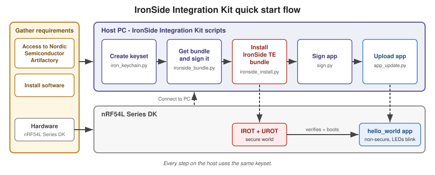

# IronSide Integration Kit quick start

This quick start takes you from a new device to a running application.

By completing this quick start, you will set up the requirements, download and sign IronSide TE bundle, install it on the device and program the prebuilt `hello_world` sample.



**You are using a pre-release version of IronSide TE and IronSide Integration Kit.
Everything is subject to change before the official release.**

> **Note:** The commands in this quick start assume that the IronSide Integration Kit root directory is your working directory.

## Requirements

You need the following to work with IronSide TE and complete this quick start:

- Access to Nordic Semiconductor Artifactory - contact your Nordic Semiconductor representative for access

- One of the supported nRF54L Series Development Kits: nRF54LM20 DK (preferred), nRF54LV10 DK, or nRF54L15 DK

  The [DFU image](architecture.md#dfu-image) receives firmware updates on the first virtual serial port (port 0) of the DK at 1000000 baud with hardware flow control (RTS/CTS).
  Your computer and its serial port driver must support hardware flow control on that port.

  > **Note:** On the nRF54L15 DK, you must enable hardware flow control for port 0 in the board controller, for example with the [Board Configurator app](https://docs.nordicsemi.com/bundle/nrf-connect-board-configurator/page/index.html) in nRF Connect for Desktop.
  > Without it, firmware updates through the DFU image fail.

- nRF Util with the following commands required by some of the scripts:

  - `device` **>= 2.17.2**
  - `mcu-manager` **>= 0.12.3**

  Check nRF Util's [requirements](https://docs.nordicsemi.com/r/bundle/nrfutil/page/guides/installing.html) and [download its executable and put it in PATH](https://docs.nordicsemi.com/r/bundle/nrfutil/page/guides/installing.html/installing-nrf-util-from-the-web-default).
  With nRF Util installed, run the following commands to install the required nRF Util commands:

  ```sh
  nrfutil install device
  nrfutil install mcu-manager
  ```

  This installs the latest versions of the `device` and `mcu-manager` commands.

- [SEGGER J-Link](https://www.segger.com/downloads/jlink/#J-LinkSoftwareAndDocumentationPack) - same version as the one required by nRF Util.
- Python 3.10+ and the Python packages listed in `requirements.txt`:

  ```sh
  pip install -r requirements.txt
  ```

To build the IronSide Integration Kit samples from source, you will also need the [sample build prerequisites](../samples/PREREQUISITES.md), but this is beyond the scope of this quick start.

At the end of the procedure, the application prints its output to UART.
You can use any serial terminal emulator to see the output, for example the [Serial Terminal app](https://docs.nordicsemi.com/bundle/swtools_docs/page/app/pc-nrfconnect-serial-terminal/index.html) in [nRF Connect for Desktop](https://www.nordicsemi.com/Software-and-Tools/Development-Tools/nRF-Connect-for-desktop).
Use the second virtual serial port (port 1) of the DK with the following serial port settings:

| Baud rate | Data bits | Stop bits | Parity | Hardware flow control |
|-----------|-----------|-----------|--------|-----------------------|
| 115200    | 8         | 1         | None   | None                  |

For more information, see [Identifying serial ports](https://docs.nordicsemi.com/r/bundle/nrf-connect-for-desktop/page/app/pc-nrfconnect-serial-terminal/selecting_serial_port.html/identifying-serial-ports).

## Bring up a new device

> **Notes:**
>
> - You need to run the commands in this section from the IronSide Integration Kit root directory using your operating system's Python syntax.
> - When the DK is referenced, the commands mention the preferred nRF54LM20 DK.

To bring up a new device, complete the following steps:

1. Verify that the OS keyring is usable:

   ```sh
   scripts/iron_keychain.py list
   ```

   If the OS keyring is usable, the command prints the keyring backend in use, followed by `no indexed keysets` or the names of the existing keysets.
   If the command fails, replace `keyring:dev` with `dir:keyset-dev` in every command that follows to store the keyset in the `keyset-dev` directory instead of the OS keyring.
   For more information, see [Generating a keyset into a directory](installing-and-updating-firmware.md#generating-a-keyset-into-a-directory).

2. Create a local set of required keys (*keyset*), named `dev` for development purposes:

   ```sh
   scripts/iron_keychain.py new --keyset keyring:dev
   ```

   This is required because the IronSide TE release artifact does not contain signed images.
   You only need to generate the keyset once and it will be used in the steps that follow.
   For more information, see [IronSide TE keyset](architecture.md#ironside-te-keyset).

3. Download IronSide TE from Nordic Semiconductor Artifactory, sign it with the `dev` keyset, and store the signed bundle in `ironside-te.iron.zip`:

   ```sh
   scripts/ironside_bundle.py init ironside-te.iron.zip -S keyring:dev --soc nrf54lm20b
   ```

   In this command, provide the SoC of your DK with `--soc`: `nrf54lm20b` for the nRF54LM20 DK, `nrf54lv10a` for the nRF54LV10 DK, or `nrf54l15` for the nRF54L15 DK.

   If more than one DK is connected, add `--serial-number` with the J-Link serial number of the DK (list them with `nrfutil device list`).

   By default, the command opens a browser for authentication.

4. Configure provisioning to enroll the User SEED that the device derives its keys from.
   Currently produced devices have no pre-programmed Nordic SEED, so set `--provision-user-seed` to `yes`:

   ```sh
   scripts/ironside_bundle.py update-keys ironside-te.iron.zip --keyset keyring:dev \
   --provision-user-seed yes
   ```

   `update-keys` sets the option and writes it into the provisioning firmware in the bundle.
   You must set the option for the first installation on a new device.
   The default value, `no`, does not seed the device, so the installation stops on a new device.
   With the default `--ikg-seed-select auto`, the installation sets the IKG SEED selection to User SEED, because User SEED is Locked.
   The SEED slots are permanent once IronSide TE is installed on the device.
   For details, see [User SEED provisioning](configuring-ironside-te.md#user-seed-provisioning).

5. Connect the DK to your computer.

6. Install the signed IronSide TE images on the device:

   ```sh
   scripts/ironside_install.py ironside-te.iron.zip --keyset keyring:dev
   ```

7. Sign the prebuilt application image for your DK.

   The commands in this step and the one that follows use the image for the nRF54LM20 DK.
   For the nRF54LV10 DK or the nRF54L15 DK, replace `nRF54LM20-DK` in the file names with `nRF54LV10-DK` or `nRF54L15-DK`.

   Pass the same `--soc` value to `sign.py` as to `ironside_bundle.py init`.

   ```sh
   scripts/sign.py hello_world_app_nRF54LM20-DK.hex \
   --out hello_world_app_nRF54LM20-DK.signed.hex \
   --keyset keyring:dev --soc nrf54lm20b
   ```

8. Upload the signed application image to the device:

   ```sh
   scripts/app_update.py hello_world_app_nRF54LM20-DK.signed.hex \
   --keyset keyring:dev
   ```

   When the application image starts, the LEDs on the DK start to blink in a crossing pattern.

## Resetting bring-up procedure

To start the bring-up procedure again on a device that already has IronSide TE installed, for example with a different keyset, first erase the device with the following nRF Util command:

```sh
nrfutil device recover
```

If the command fails, or to reinstall IronSide TE without erasing the device first, see [Reinstalling IronSide TE](installing-and-updating-firmware.md#reinstalling-ironside-te).

## Next step

After you bring up the device, see the following documentation and tools:

- [Installing and updating firmware](installing-and-updating-firmware.md): the individual steps behind this quick start, and how to update or reinstall IronSide TE and the application firmware.
- [IronSide Trusted Execution User Guide](README.md): the boot flow, the architecture, configuration, secure services, lifecycle states, authenticated debug, and artifacts.
- [IronSide TE production programming guide](SPEC-production-programming.md): how to prepare the programming artifacts from an IronSide bundle and program devices on a production line.
- Host tools in `scripts/`: every tool takes `--help`.
- [IronSide Integration Kit samples](../samples/README.md): what each sample demonstrates.
- [Sample build prerequisites](../samples/PREREQUISITES.md): toolchain and nrfx/CMSIS setup for building samples from source.
- [IronSide TE Client](../client/README.md) and `client/include/ironside_client/`: the Client API.
